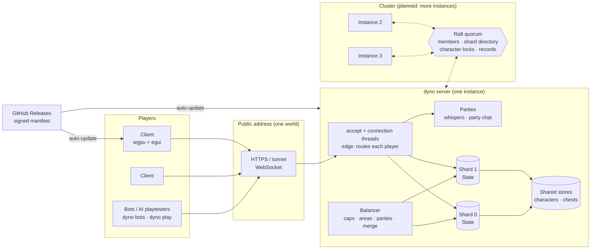
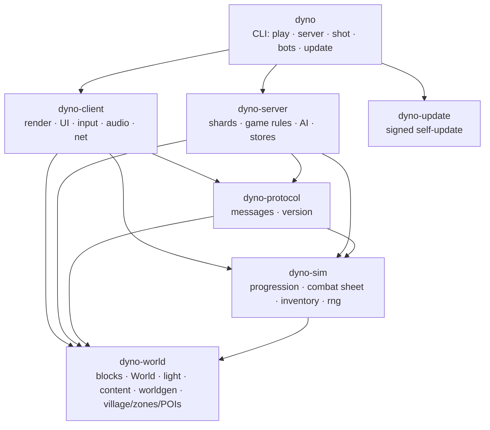
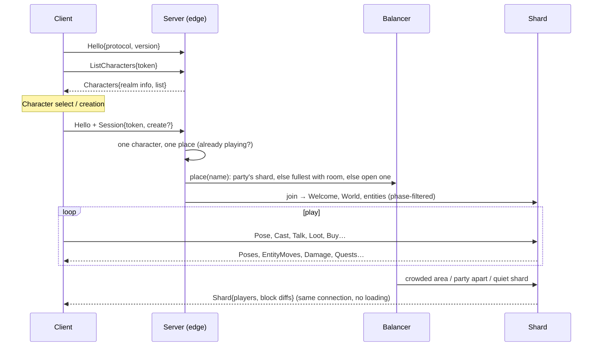
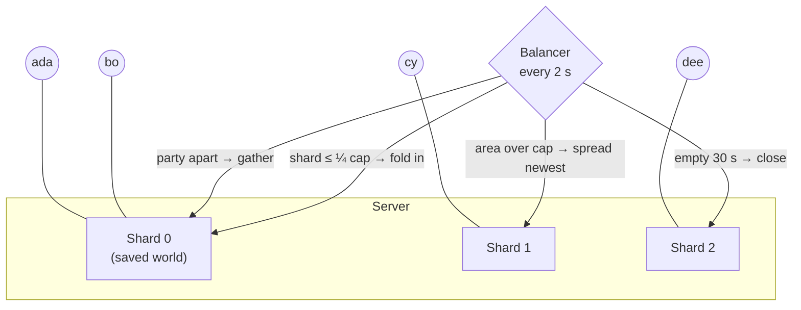
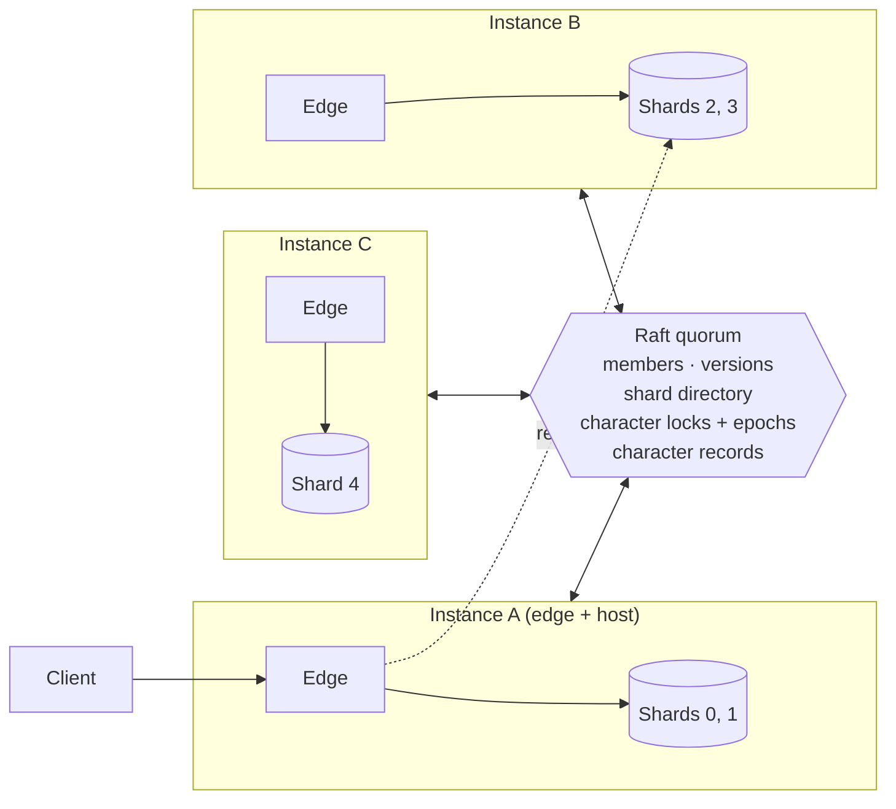
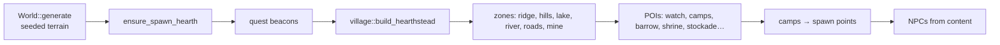
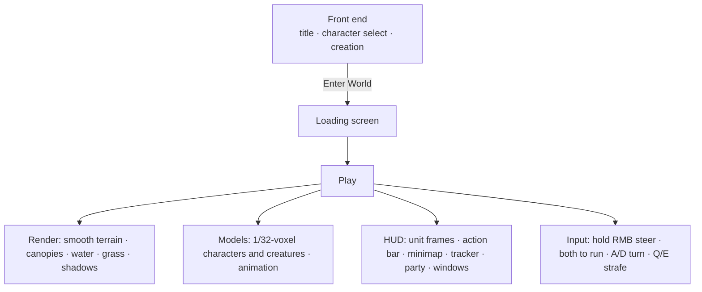
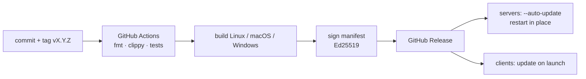

# Hearthblock Online: architecture

This is the map of how the game is built and why. Read it before changing
anything structural; add to the decision log at the end when you do.

Hearthblock Online is a classic fantasy MMORPG (WoW-like progression, quests,
classes) running on **Dyno**, a Rust engine with a voxel world. One binary,
`dyno`, is the game client, the server, the updater and the dev tools.

## 1. The big picture

- **One world, no realms.** Players never pick a server. The client has one
  address built in (`DYNO_DEFAULT_SERVER`, overridable in Options for
  development). Behind it, the world is split into **shards** (whole copies
  of the world) automatically.
- **Content is data.** Items, creatures, NPCs, quests, classes, abilities,
  professions, areas, camps, phases and merchant stock live in
  `content/hearthblock.json`. The server sends it to every client at join.
- **The server is authoritative** for everything except moment-to-moment
  movement (the client simulates its own player; the server checks it).

## 2. Crates

| Crate | Owns |
|---|---|
| `dyno-world` | The block grid (`World`, 1 m blocks), lighting, the content schema and parser, world generation, and the builders for Hearthstead (`village.rs`), the zones (`zones.rs`) and points of interest (`poi.rs`). |
| `dyno-sim` | Rules shared by client and server: the XP curve and mob scaling (`progression.rs`), the character sheet and armour maths (`character.rs`), inventory and stacks. |
| `dyno-protocol` | Every message between client and server (postcard over WebSocket), `PROTOCOL_VERSION` (now 14). A version mismatch is refused with a clear reason. |
| `dyno-server` | The game: shards, players, creatures and their AI, abilities and auras, quests, loot, merchants, rested XP, professions, camps, events, phasing, parties, persistence, migration. |
| `dyno-client` | Rendering (wgpu), the UI (egui, themed), input (classic MMO controls), audio, the front end (title, character select and creation), the minimap, headless screenshots. |
| `dyno-update` | Checks GitHub Releases, verifies the signed manifest, swaps the binary. Used by clients and by servers (`--auto-update`). |

## 3. A player's session

- **Identity:** an install has a random token. A character belongs to the
  token that made it; names are unique in the world.
- **Joining:** the edge checks the name is not online anywhere, picks a
  shard (`Server::place`), and the shard runs `State::join`.
- **Moving between shards** happens only at a quiet moment
  (`State::movable`: alive, not casting, not in combat, nothing hunting
  you). The old shard `detach`es the `Player`, the new one `attach`es it and
  sends `ServerMsg::Shard` with the people there and the blocks that differ.
  The connection never drops.

## 4. Shards, areas and phasing

**Shards.** A shard is a whole copy of the world (`State`) with its own
creatures, NPCs, corpses and events. Shards share the character store,
chests, the day clock and parties, so nothing can be duplicated by moving.
Shard 0 owns the saved world; others are copies of the world as built at
start (`Server::base`).

| Rule | Setting | Default |
|---|---|---|
| A shard fills to `shard_cap` before another opens; joins go to the fullest shard with room (busy worlds are more fun) | `shard_cap` | 40 |
| No area of a shard holds more than `area_cap`; the newest arrivals are moved to the quietest copy of that area | `area_cap` | 16 |
| Party members are drawn to the leader's shard (party slack: 5 over the cap) | | |
| A shard at ¼ of the cap or less is folded into a busier one, if no area would become crowded | | |
| Empty shards close after 30 s (never shard 0) | | |
| At most `max_shards` per server | `max_shards` | 16 |

Builder worlds (unprotected content) never shard.

**Phasing** is a per-player view inside a shard. Content defines phases
(`"phases": [{"key": "stockade_taken", "done": "rook_varn"}]`); NPCs and
camps can be shown only in a phase (`"phase": "stockade_taken"`) or only
outside it (`"!stockade_taken"`). Each player carries a phase mask, updated
when quests complete.

- **Visibility** is enforced at one chokepoint, `State::broadcast`: messages
  about a phased entity go only to players who see it, and `EntityMoves` is
  filtered per player. Join and `attach` send only visible entities.
- **Interaction** is enforced on the server: Talk, Cast, AutoAttack, Loot,
  LootTake and Buy refuse unseen entities; creatures only hunt players who
  see them; area damage skips unseen creatures; a phased creature's corpse
  keeps its phase.
- **Today's phases:** with Rook Varn dead, the stockade's Ashcloak camps are
  gone for you and Corporal Ansel holds it; the Barrow Warden and the
  Hollow Foreman stay dead for those who finished their quests.

## 5. The cluster (decided; being built)

The next step runs shards on many server instances that find each other and
agree on the world's state.

| Decision | Why |
|---|---|
| Every instance is an **edge**, a **shard host** and a **cluster member** | One public address can front the whole cluster; a client stays on the edge it reached and the edge relays to whichever instance hosts its shard, so moves never reconnect. |
| Consensus with an existing Raft library (`raft` 0.7, tikv) | Hand-rolled consensus is how worlds lose items. The replicated state stays tiny. |
| Replicated state: members (address, protocol, content version, capacity), the shard directory, a lock per online character with an **epoch**, and character records | A character can be online in one place only; every save carries the lock's epoch and stale writers are refused. |
| **Fencing:** an instance that loses the quorum stops writing and drops its players | Prevents duplicated characters and items during a network split. |
| Cross-instance transfer: freeze, write the full player under a new epoch, attach on the target, switch the edge route, drop the source copy; unfreeze on failure | Same seamless move as within one instance. |
| New instances fetch the base world from the cluster and verify its hash | The live world holds migrated player builds; it cannot be regenerated from the seed. |
| Join handshake carries protocol and content versions; a mismatched instance drains instead of serving | Instances self-update independently. |
| The cluster link is authenticated with a secret kept out of git and logs, and is never exposed through the public tunnel | |
| A single instance is a quorum of one; the live server's command line keeps working | |
| Tolerance: 2 instances tolerate no failure; 3 tolerate one | Raft majority. |

Tests to pass before shipping: three local processes; kill the leader mid
transfer; partition one node; assert no character is online twice and item
counts are unchanged.

## 6. The world

- 384 × 96 × 384 blocks; 14 areas with level bands, camps with respawn
  timers and rare elites, a three-level mine.
- Builders are idempotent: a restart builds nothing and leaves the file
  unchanged. Older, smaller worlds grow in place (`migrate::expand`), keeping
  every build and moving every saved position, with `.before-N` backups.
- Players cannot change the RPG world except by gathering (nodes deplete and
  regrow).

## 7. Game systems (server)

| System | Where | Notes |
|---|---|---|
| Classes, abilities, resources, GCD | `abilities.rs` | Warrior, Paladin, Hunter, Rogue, Priest, Mage; rage/mana/energy; casts, DoTs, HoTs, buffs, combo points, stuns, roots. |
| Gear and sheet | `gear.rs`, `dyno-sim/character.rs` | 17-slot paper doll; armour types; auto-attack and auto-shot. |
| Creatures and AI | `creatures.rs`, `camps.rs` | Levels by area; aggro radius by level difference; threat; leashing; abilities (charge, bolt, flee); phase-aware targeting. |
| Quests | `rpg.rs` | Kill, collect, talk, explore; chains; rewards with choices. |
| Loot | `loot.rs` | Corpses hold loot for the killer for 60 s, then anyone; coins; the body glints until empty. |
| Merchants | `loot.rs` + content `sells` | Price = 4 × sell value unless set; shift-click buys five. |
| Rested XP | `loot.rs` | 5 % of a level per hour in a safe area (1.25 % elsewhere), online or off; cap 1.5 levels; kills give double until spent. |
| Professions | `professions.rs` | Gathering by cast, skill-ups by colour. |
| Events | `events.rs` | Nightfall Incursion: waves at a gate after dusk. |
| Parties | `party.rs` | Up to 5; invites across shards; party chat and whispers. |
| Persistence | `store.rs` | JSON for characters, chests, server meta; binary world. Saved every 10 s and on stop. |

## 8. The client

- **Rendering** (`render.rs`, `terrain_mesh.rs`): natural ground is a smooth
  surface (surface nets with cube topology), built blocks are cubes (moving
  to fine "detail blocks"), leaves are puffy canopies, water has a lowered
  surface with foam, lamps have halos, sun shadows and a colour grade.
  Feet stand on the drawn surface (`terrain_mesh::Ground`).
- **Models** (`models.rs`, `voxmodel.rs`): procedural 1/32-block voxel
  characters and creatures, rebuilt each frame. A shared animation contract
  (skeletons and an `Anim` set every model must implement) is being built.
- **UI** (`theme.rs`, `rpg_ui.rs`, `screens.rs`, `front.rs`, `minimap.rs`):
  a Cinzel/Crimson gold-and-wood theme; character, bags, spellbook and skills
  windows; quest dialogs and log; loot and merchant windows; party frames.
- **Headless tools:** `dyno shot` renders the real client to an image
  (`--ui hud|pack|talk|loot|vendor|…`, `--front title|select|class|look|name|…`).

## 9. Shipping

- Nothing ships unless format, lint and every test pass.
- The signing key never leaves the release secret; binaries verify the
  manifest signature before swapping.
- Servers self-update within about 5 minutes and restart with the same
  command line; saves migrate unaided (rehearse on a copy of the live world
  first).

## 10. Testing

| Kind | What |
|---|---|
| Unit tests | Per crate: content parsing, progression, parties, rested XP, migration, terrain mesh, minimap… |
| Protocol tests | `crates/dyno-client/tests/survival_loop.rs`: real server, real client networking: the survival loop, quests and classes, Nightfall, characters, loot and merchants, phasing, shards and parties, area crowding. |
| Screenshots | `dyno shot` against a test server; front-end pages; animation contact sheets. |
| Playtests | Headless bot swarms with a "fun" report (reward cadence, droughts, time to first kill/level, deaths, stuck spots) and a text interface for AI playtesters (in progress). |

## 11. Decision log

| # | Decision | Why |
|---|---|---|
| 1 | Rust engine, one binary for client/server/tools (Luau scripting is in the original spec but not used yet) | Simple shipping; one auto-updater. |
| 2 | Pivot from a Minecraft-like to a classic MMORPG on the same engine | The user's direction: WoW-like progression, quests, classes. |
| 3 | Content as data (one JSON pack) | Designers iterate without code; the server ships it to clients. |
| 4 | Classic MMO controls and camera; no crosshair | Away from the Minecraft feel. |
| 5 | Smooth terrain from the block grid, not a finer grid | Keeps saves, lighting and physics on 1 m blocks. |
| 6 | Detail blocks for built geometry, not finer storage | Same reason; fine look without multiplying memory per shard. |
| 7 | No realms; one world, sharded automatically | The user's direction; players never choose a server. |
| 8 | Shards are whole-world copies; crowding managed per area | Seamless moves; no second entity model; density where it matters. |
| 9 | Phasing as per-player visibility, enforced on the server | Story changes the world for you without splitting players. |
| 10 | Moves only at quiet moments, never in combat | Players should never notice. |
| 11 | Loot by hand from corpses; merchants; rested XP | Classic MMO loop and pacing. |
| 12 | Multi-instance cluster with a Raft quorum; edges relay | Scale out behind one address; no lost or duplicated characters. |
| 13 | Animation contract: skeletons with an exhaustive `Anim` set | Every model can do every expected action; missing ones fail to compile. |
| 14 | Playtest with bot swarms and AI agents; measure fun | Aim for fun objectively: reward cadence, droughts, deaths, stuck spots. |
