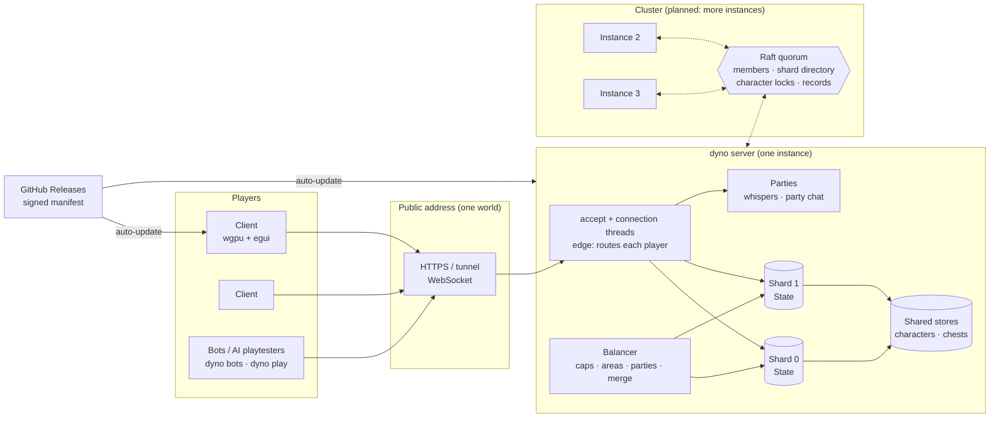
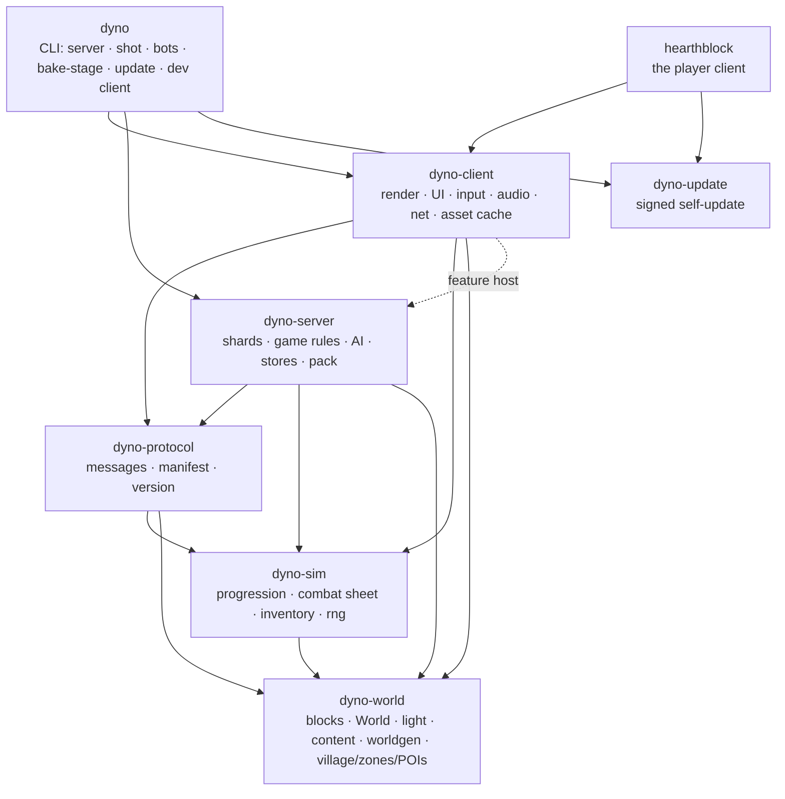
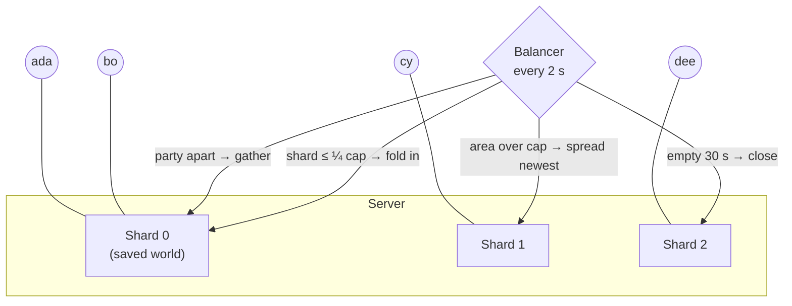
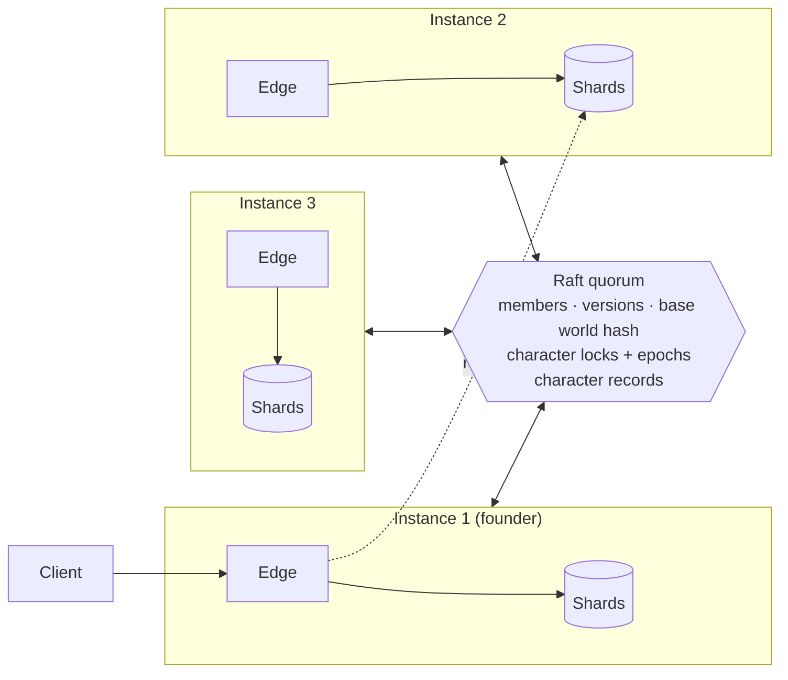
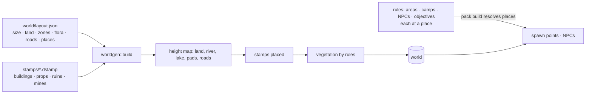
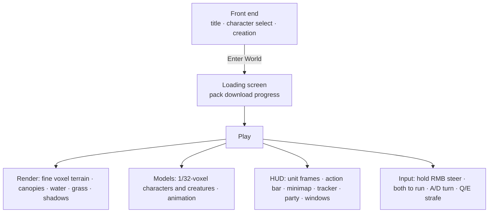
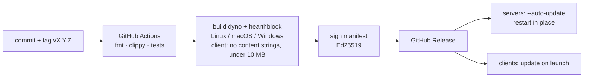

# Hearthblock Online: architecture

This is the map of how the game is built and why. Read it before changing
anything structural; add to the decision log at the end when you do.

Hearthblock Online is a classic fantasy MMORPG (WoW-like progression, quests,
classes) running on **Dyno**, a Rust engine with a voxel world. Two
binaries: `hearthblock`, the player client (an engine with no content: the
server streams the content pack), and `dyno`, the server, tools, bots and a
dev client that can host a local world. Both update themselves.

## 1. The big picture



- **One world, no realms.** Players never pick a server. The client has one
  address built in (`DYNO_DEFAULT_SERVER`, overridable in Options for
  development). Behind it, the world is split into **shards** (whole copies
  of the world) automatically.
- **Content is data.** Items, creatures, NPCs, quests, classes, abilities,
  professions, areas, camps, phases and merchant stock live in
  `content/rules/hearthblock.json`, one file of the content pack
  (`content/`, see `docs/design/data-and-streaming.md`). The server hashes
  the pack into a manifest; clients download the files they lack at join and
  cache them by hash.
- **The server is authoritative** for everything except moment-to-moment
  movement (the client simulates its own player; the server checks it).

## 2. Crates



| Crate | Owns |
|---|---|
| `dyno-world` | The block grid (`World`, 1 m blocks in 16³ sections: all-one-block sections free, others palette-packed, shared copy-on-write between shards; clients hold only the streamed sections), the far view's heightmap tiles (`far.rs`), lighting (stored the same way), the content schema and parser, and building a world from data: the layout (`layout.rs`), stamps (`stamp.rs`) and the generator that shapes land, lays roads, places stamps and scatters vegetation (`worldgen.rs`). |
| `dyno-sim` | Rules shared by client and server: the XP curve and mob scaling (`progression.rs`), the character sheet and armour maths (`character.rs`), inventory and stacks. |
| `dyno-protocol` | Every message between client and server (postcard over WebSocket), the pack `Manifest`, `PROTOCOL_VERSION` (now 21). A version mismatch is refused with a clear reason. |
| `dyno-server` | The game: shards, world streaming and area of interest (`stream.rs`), players, creatures and their AI, abilities and auras, quests, loot, merchants, rested XP, professions, camps, events, phasing, parties, persistence, migration. The content pack (`pack.rs`: loading, hashing, the built-in pack embedded from `content/`, each session's asset outbox). |
| `dyno-client` | Rendering (wgpu), the UI (egui, themed), input (classic MMO controls), audio, the front end (title, character select and creation), the minimap, headless screenshots. The asset store (`assets.rs`) and the cache of pack files (`cache.rs`). Local hosting only with the `host` feature. |
| `dyno-update` | Checks GitHub Releases, verifies the signed manifest, picks the artifact named like its own executable (`dyno` or `hearthblock`), swaps the binary. Used by clients and by servers (`--auto-update`). |
| `dyno` | Server, tools, bots and the dev client (`host` on). |
| `hearthblock` | The player client: `dyno-client` without `host`. No server, world builders or content in it; checked by `.github/scripts/check-client.sh`. |

## 3. A player's session

```mermaid
sequenceDiagram
  participant C as Client
  participant E as Server (edge)
  participant B as Balancer
  participant S as Shard
  C->>E: Hello{protocol, version}
  C->>E: ListCharacters{token}
  E-->>C: Characters{realm info, list}
  Note over C: Character select / creation
  C->>E: Hello + Session{token, create?}
  E->>E: one character, one place (already playing?)
  E->>B: place(name): party's shard, else fullest with room, else open one
  E->>S: join → Welcome{manifest, hearth, view}
  C->>E: Want{hashes the cache lacks}
  E-->>C: Asset chunks (≤ 64 KB, after game messages, 256 KB/s budget)
  Note over C: rules parsed from the pack; files cached by hash
  S-->>C: Sections nearest first (join budget), until the land round the spawn is here
  Note over C: loading screen ends
  loop play
    C->>S: Pose, Cast, Talk, Loot, Buy…
    S-->>C: Sections/SectionsGone as you move; Poses, EntityMoves… within your area of interest
  end
  B->>S: crowded area / party apart / quiet shard
  S-->>C: Shard{players, block diffs in the sections you hold}  (same connection, no loading)
```

- **Identity:** an install has a random token. A character belongs to the
  token that made it; names are unique in the world.
- **Joining:** the edge checks the name is not online anywhere, picks a
  shard (`Server::place`), and the shard runs `State::join`.
- **Moving between shards** happens only at a quiet moment
  (`State::movable`: alive, not casting, not in combat, nothing hunting
  you). The old shard `detach`es the `Player`, the new one `attach`es it and
  sends `ServerMsg::Shard` with the people there and the blocks that differ
  in the sections the client holds (it keeps its sections; the world is
  never sent again).
  The connection never drops.

## 4. Shards, areas and phasing



**Shards.** A shard is a whole copy of the world (`State`) with its own
creatures, NPCs, corpses and events. Shards share the character store,
chests, the day clock and parties, so nothing can be duplicated by moving.
Shard 0 owns the saved world; others are copies of the world as built at
start (`Server::base`).

| Rule | Setting | Default |
|---|---|---|
| A shard fills to `shard_cap` before another opens; joins go to the fullest shard with room (busy worlds are more fun) | `shard_cap` | 40 |
| No area of a shard holds more than `area_cap`; the newest arrivals are moved to the quietest copy of that area | `area_cap` | 16 |
| Party members are drawn to the leader's shard (party slack: 5 over the cap) | | |
| A shard at ¼ of the cap or less is folded into a busier one, if no area would become crowded | | |
| Empty shards close after 30 s (never shard 0) | | |
| At most `max_shards` per server | `max_shards` | 16 |

Builder worlds (unprotected content) never shard.

**Phasing** is a per-player view inside a shard. Content defines phases
(`"phases": [{"key": "stockade_taken", "done": "rook_varn"}]`); NPCs and
camps can be shown only in a phase (`"phase": "stockade_taken"`) or only
outside it (`"!stockade_taken"`). Each player carries a phase mask, updated
when quests complete.

- **Visibility** is enforced at one chokepoint, `State::broadcast`, together
  with the area of interest (section 6): messages
  about a phased entity go only to players who see it, and `EntityMoves` is
  filtered per player. Entities are introduced to a player only when they
  are near and visible (`stream.rs`, the interest pass); a phase change
  forgets what left the phase.
- **Interaction** is enforced on the server: Talk, Cast, AutoAttack, Loot,
  LootTake and Buy refuse unseen entities; creatures only hunt players who
  see them; area damage skips unseen creatures; a phased creature's corpse
  keeps its phase.
- **Today's phases:** with Rook Varn dead, the stockade's Ashcloak camps are
  gone for you and Corporal Ansel holds it; the Barrow Warden and the
  Hollow Foreman stay dead for those who finished their quests.

## 5. The cluster (built; first version)

Shards run on many server instances that find each other, agree on the
world's state through a Raft quorum, and pass players between them. A server
started without cluster flags creates none of this and behaves as a single
instance.



**Running three instances on one machine:**

```sh
head -c 32 /dev/urandom | base64 > secret && chmod 600 secret   # never commit or print it
dyno server --port 7551 --world a/world.dynw --cluster 127.0.0.1:7561 --cluster-secret-file secret
dyno server --port 7552 --world b/world.dynw --cluster 127.0.0.1:7562 --join 127.0.0.1:7561 --cluster-secret-file secret
dyno server --port 7553 --world c/world.dynw --cluster 127.0.0.1:7563 --join 127.0.0.1:7562 --cluster-secret-file secret
```

The secret can also come from `DYNO_CLUSTER_SECRET` (at least 16 characters).
`--advertise HOST:PORT` sets the address other instances dial (default: the
`--cluster` address); `--cluster-dir` holds the Raft log, the instance id and
the base world (default: `cluster/` beside the world file). Players can
connect to any instance's game port.

### Built

| Part | How | Where |
|---|---|---|
| Cluster link | TCP with a mutual HMAC-SHA256 challenge over both nonces with the shared secret; frames of postcard; a reconnecting queue per peer. The secret is never logged. The link never blocks on game work: relayed client messages go through a worker per connection. | `cluster/link.rs` |
| Quorum | `raft` 0.7 (tikv): check-quorum and pre-vote; a write-ahead log and snapshots on disk, compacted every 400 entries; snapshots carry the whole state machine. Proposals from any instance (followers forward to the leader). | `cluster/raftnode.rs` |
| Replicated state | Members (address, protocol, content, version, capacity, down), the base world hash, a lock per online character with an **epoch**, and character records. Applying a command is deterministic. | `cluster/machine.rs` |
| Joining | A new instance asks any member (a seed); the leader assigns an id, adds it as a voter, and the newcomer fetches the base world from a member, checking it against the recorded hash. The founder records the hash and imports its existing characters once. | `cluster/mod.rs`, `lib.rs` |
| One character, one place | Joining claims the character's lock through the quorum (refused if another live instance holds it). Saves every 10 s and the final release carry the epoch; stale writes are refused, and a refused save drops the player locally. | `clustered.rs` |
| Fencing | An instance that hasn't heard the quorum for 5 s drops all its players (without writing) and refuses new ones. The leader marks an instance silent for 12 s as down, which releases its characters. | `clustered.rs`, `cluster/mod.rs` |
| Relaying | The edge a client reached places it cluster-wide: where its character is already held, else the fullest shard with room on any instance, else the least loaded instance. It relays raw client and server messages to that host over the link, so the client never reconnects. | `clustered.rs`, `lib.rs` (session) |
| Moving between instances | Freeze (detach at a quiet moment), propose a Move with the epoch, the new host adopts the player and sends a `Shard` message (people there, block differences), and the edge's relay switches. If the Move doesn't commit (for example, the leader died), the player is unfrozen where they were; if adoption fails, the lock moves back. | `clustered.rs` |
| Load and balancing | Each instance reports its shards, players and versions every second. A quiet instance (a quarter of the cap or less) folds its players into a busier one with room. Operators can move a player with `/instance N`. | `clustered.rs` |
| Version gating | An instance whose protocol or content differs from the leader's drains: it refuses new players and is not chosen as a host. Content means the rules' name and version and the content pack's hash, so one changed texture is enough. | `clustered.rs`, `lib.rs` (`content_identity`) |
| Pack files when relayed | The edge answers `Want` from its own pack and names its own manifest in the relayed `Welcome`; `Want` never crosses the link. | `lib.rs` (session) |

**Tests** (`crates/dyno-server/src/cluster/tests.rs`, `crates/dyno-client/tests/cluster.rs`):
- three instances agree; a new leader is elected after the old one dies;
  without a quorum, instances fence;
- a cut-off instance is marked down and its characters released;
- a restarted founder replays its log;
- a player connected to one instance plays on another through the relay,
  then moves to a third with nothing lost;
- the leader is killed just as a move starts: the move doesn't commit, the
  player stays in exactly one place with the same items, and a later move
  works under the new leader;
- a cut-off host drops its player, who can't log in elsewhere until the host
  is declared down, then can, with exactly the last saved items;
- a new instance takes the founder's world (hash checked), and a wrong
  secret can't join;
- an instance on a different content version drains, and so does one whose
  pack has one more file;
- a player relayed through an edge downloads the pack from the edge, and a
  second relayed join with the same cache downloads nothing.

It was also tested with three real `dyno server` processes on one machine,
using a full-size 384 world, the relay and headless screenshots.

### Not built yet

- **Parties and whispers are per instance.** Party gathering, party frames
  and `/w` only reach players hosted on the same instance; `/who` lists one
  instance.
- **Chests are per instance.** They're unused in the RPG world, but a
  chest's contents aren't replicated.
- **The shard directory isn't replicated.** Shard ids are local to each
  instance; placement uses the load reports instead.
- **Cluster membership only grows.** There is no command to remove an
  instance for good: a stopped one stays a voter and counts against the
  quorum until it returns. Two instances tolerate no failure; three tolerate
  one.
- **Placement is only as fresh as the last load report.** A burst of joins
  within a second can overfill a shard slightly.
- **The day clock and weather are per instance.**
- **Messages in flight during a move can be lost.** For the few
  milliseconds while a relay switches hosts, a client message can be dropped.
- **Saves happen every 10 s.** When an instance is fenced, up to 10 s of a
  player's progress since the last save is lost. Nothing is ever duplicated.
- **The live server doesn't use any of this.** It runs without cluster
  flags. Running a cluster in production needs a stable public address and
  more than one machine, which are hosting decisions.

## 6. The world



- **The world is data** (docs/design/world-layout.md). Hearthstead, the
  roads, the river and the lake, every camp, farm and ruin are in
  `content/world/layout.json`; every structure is a stamp. Proportions and
  distances follow docs/design/scale.md and are measured by
  `crates/dyno-server/tests/world_scale.rs`.
- **Size** is one value in the layout: 2048 × 256 × 2048. A smaller size
  draws the places closer together in proportion; nothing else changes.
- A saved world keeps the layout version it was built from; another
  version rebuilds it once, with backups, and moves every character to its
  place (`migrate::rebuild`). Worlds without a layout (builder worlds) are
  generated from a seed and can still grow in place (`migrate::expand`).
- **Streaming** (`stream.rs`, docs/design/data-and-streaming.md §4): the
  server sends each client the 16³ sections within its view (160 m, whole
  columns), nearest first, within a per-player budget (2 MB/s until the
  first view is complete, then 256 KB/s), and `SectionsGone` past view +
  24 m. Block edits go only to clients that hold the section. A client
  hears about entities, poses and actions within 100 m (forgotten past
  112 m). `--view`, `--aoi`, `--section-rate`, `--join-section-rate`.
- 14 areas with level bands, camps with respawn timers and rare elites, a
  three-level mine.
- Players cannot change the RPG world except by gathering (nodes deplete and
  regrow).

## 7. Game systems (server)

| System | Where | Notes |
|---|---|---|
| Classes, abilities, resources, GCD | `abilities.rs` | Warrior, Paladin, Hunter, Rogue, Priest, Mage; rage/mana/energy; casts, DoTs, HoTs, buffs, combo points, stuns, roots. |
| Gear and sheet | `gear.rs`, `dyno-sim/character.rs` | 17-slot paper doll; armour types; auto-attack and auto-shot. |
| Creatures and AI | `creatures.rs`, `camps.rs` | Levels by area; aggro radius by level difference; threat; leashing; abilities (charge, bolt, flee); phase-aware targeting. |
| Quests | `rpg.rs` | Kill, collect, talk, explore; chains; rewards with choices. |
| Loot | `loot.rs` | Corpses hold loot for the killer for 60 s, then anyone; coins; the body glints until empty. |
| Merchants | `loot.rs` + content `sells` | Price = 4 × sell value unless set; shift-click buys five. |
| Rested XP | `loot.rs` | 5 % of a level per hour in a safe area (1.25 % elsewhere), online or off; cap 1.5 levels; kills give double until spent. |
| Professions | `professions.rs` | Gathering by cast, skill-ups by colour. |
| Events | `events.rs` | Nightfall Incursion: waves at a gate after dusk. |
| Parties | `party.rs` | Up to 5; invites across shards; party chat and whispers. |
| Persistence | `store.rs` | JSON for characters, chests, server meta; binary world. Saved every 10 s and on stop. |

## 8. The client



- **Rendering** (`render.rs`, `terrain_mesh.rs`, `fine.rs`): natural ground
  is fine voxels (8 a metre near the camera, coarser further out), each
  block's sub-grid shaped by the blocks around it, with a colour per voxel;
  built blocks are cubes or voxel "detail blocks", leaves are canopies,
  lamps have halos, sun shadows and
  a colour grade. Feet stand on the top of the fine column under them
  (`terrain_mesh::Ground`); picking and collision stay per block.
- **Water** (`water.rs`): its own pass after the solid world, which it
  reads (picture and depth): colour by depth with the bed showing at the
  shore, the sky, land and lights mirrored, foam at shores and obstacles,
  ripples and glints in voxel squares, falls where the level steps down, and
  a fog with the eyes under water. The look, per kind of water and place, is
  in `render.json`; the setting `water_quality` (0–2) drops the mirror rays,
  then the reading of the picture.
- **Models** (`models.rs`, `voxmodel.rs`): procedural 1/32-block voxel
  characters and creatures, rebuilt each frame. A shared animation contract
  (skeletons and an `Anim` set every model must implement) is being built.
- **UI** (`theme.rs`, `rpg_ui.rs`, `screens.rs`, `front.rs`, `minimap.rs`):
  a Cinzel/Crimson gold-and-wood theme; character, bags, spellbook and skills
  windows; quest dialogs and log; loot and merchant windows; party frames.
- **Headless tools:** `dyno shot` renders the real client to an image
  (`--ui hud|pack|talk|loot|vendor|…`, `--front title|select|class|look|name|…`).
- **Content comes from the pack** (`assets::get`, `assets::text`): the
  rules, the loading screen's words, the intro, the title news and the title
  stage (`stage/title.dynw`). The player client shows a plain title backdrop
  until its first join has cached a pack.

## 9. Shipping



- Nothing ships unless format, lint and every test pass.
- The signing key never leaves the release secret; binaries verify the
  manifest signature before swapping.
- Servers self-update within about 5 minutes and restart with the same
  command line; saves migrate unaided (rehearse on a copy of the live world
  first).
- Each release carries `dyno-<target>` and `hearthblock-<target>`. The
  signed manifest's `assets` lists only the dyno binaries (what every
  updater up to 0.6 reads, so the live server keeps updating as `dyno`);
  `programs` lists both. Updaters from 0.7 pick the program named like their
  own executable.

## 10. Testing

| Kind | What |
|---|---|
| Unit tests | Per crate: content parsing, progression, parties, rested XP, migration, terrain mesh, minimap… |
| Protocol tests | `crates/dyno-client/tests/survival_loop.rs`: real server, real client networking: the survival loop, quests and classes, Nightfall, characters, loot and merchants, phasing, shards and parties, area crowding. |
| Screenshots | `dyno shot` against a test server; front-end pages; animation contact sheets. |
| Playtests | Headless bot swarms with a "fun" report (reward cadence, droughts, time to first kill/level, deaths, stuck spots) and a text interface for AI playtesters (in progress). |

## 11. Decision log

| # | Decision | Why |
|---|---|---|
| 1 | Rust engine, one binary for client/server/tools (Luau scripting is in the original spec but not used yet) | Simple shipping; one auto-updater. |
| 2 | Pivot from a Minecraft-like to a classic MMORPG on the same engine | The user's direction: WoW-like progression, quests, classes. |
| 3 | Content as data (one JSON pack) | Designers iterate without code; the server ships it to clients. |
| 4 | Classic MMO controls and camera; no crosshair | Away from the Minecraft feel. |
| 5 | Fine voxel terrain drawn from the block grid (about 8 voxels a metre, decided per voxel from the blocks around it), not finer storage; smooth terrain (surface nets) before it | The art direction is voxel (Cube World × WoW); saves, lighting, physics and the server stay on 1 m blocks. |
| 6 | Detail blocks for built geometry, not finer storage | Same reason; fine look without multiplying memory per shard. |
| 7 | No realms; one world, sharded automatically | The user's direction; players never choose a server. |
| 8 | Shards are whole-world copies; crowding managed per area | Seamless moves; no second entity model; density where it matters. |
| 9 | Phasing as per-player visibility, enforced on the server | Story changes the world for you without splitting players. |
| 10 | Moves only at quiet moments, never in combat | Players should never notice. |
| 11 | Loot by hand from corpses; merchants; rested XP | Classic MMO loop and pacing. |
| 12 | Multi-instance cluster with a Raft quorum; edges relay (built; see section 5) | Scale out behind one address; no lost or duplicated characters. |
| 13 | Animation contract: skeletons with an exhaustive `Anim` set | Every model can do every expected action; missing ones fail to compile. |
| 14 | Playtest with bot swarms and AI agents; measure fun | Aim for fun objectively: reward cadence, droughts, deaths, stuck spots. |
| 15 | The server streams a content pack (manifest of SHA-256 hashes, `Want`/`Asset` on the game socket, a per-session budget after game messages); clients cache by hash | All content is data; one public port; play never waits behind a download; a second join downloads nothing. |
| 16 | The built-in pack is embedded in the server binary | The live server is a lone release binary with no `content/` beside it. |
| 17 | Two binaries: `hearthblock` (player client, no `host` feature) and `dyno` (server, tools, dev client); one release, the updater picks by executable name, `assets` stays dyno-only | A tiny client with no content in it, while the live server keeps updating as `dyno`. |
| 18 | The pack hash is part of an instance's content identity | Instances serving different files must not share players. |
| 19 | The world streams in 16³ sections from the shard's tick (on the player's own ordered queue, a section held from when it is queued); entities, poses and actions by area of interest at the one `broadcast` chokepoint | The client holds only what is near; worlds can grow; no quadratic pose fan-out. Sending from the shard keeps relayed players working (the edge has no world) and an edit can never overtake its section. |
| 20 | Sections are the storage everywhere: all-one-block sections cost nothing, others are packed with a palette, copies share them (copy on write); saves are section by section (`DYNW2`, `DYNW1` still loads); the far view is a coarse heightmap the server streams in 64 m tiles | A 2 km × 256 m world fits in about 160 MB per server (world and light) and 10 MB more per shard; landmarks show from 800 m with no content in the client. |
