# Visuals: critique and plan

Hearthblock Online should look like a classic fantasy MMORPG: painterly,
saturated, chunky but detailed, with strong silhouettes. The world is stored
as a 1 m block grid, and too much of it is still *drawn* as that grid. This
note is an honest look at every visual element, ranked by how loudly it says
"Minecraft", and the plan for each one.

Shots for this critique were taken headless (`dyno shot … --ui hud --time
0.3 --size 1280x720`) on a fresh 384 world (seed 20261122, hearth at
[194, 37, 195]): the plaza, the main street, the inn front, the tower, an
overhead of the town, the north watch, the logging camp, the plaza at night,
a look up at the eaves and the inside of the inn.

## Ranking: what screams Minecraft (worst first)

| # | Element | Verdict | Why it reads as Minecraft |
|---|---------|---------|---------------------------|
| 1 | Roofs | **severe** | Every roof is a 45° staircase of whole 1 m cubes. The stepped outline against the sky is *the* Minecraft silhouette, and the gable ends are staircases of plaster. Tiles are painted one tile per block, so each step shows one giant row of shingles. No eaves, ridge or fascia. |
| 2 | Lamp posts and lanterns | **severe** | A 1 m square timber column with a 1 m glowing glass cube on top. At eye level the lantern is the size of a person's torso. |
| 3 | Free-standing pillars | **severe** | The plaza's cobble columns (and the beacon pillars at quest sites) are 1 m square cobble stacks with a mossy block on top. No base, no capital, no taper. |
| 4 | Timber framing | high | Corner posts, studs and beams are each a whole 1 m block, so a half-timbered house is a checkerboard of 1 m squares: the beams are as wide as the plaster panels. Fences, stall posts and paddock rails are 1 m blocks too. |
| 5 | Props | high | Barrels, crates, hay bales, flower boxes, braziers, anvils, bookshelves are textured 1 m cubes. A crate is a cube with a crate painted on; a flower bed is a cube of flowers. |
| 6 | Tree trunks | high | Oak and birch trunks are 1 m square columns under the soft canopies, so every tree is a puffball on a square post. |
| 7 | Banners | high | Banners are 1 m thick cloth cubes, sometimes two stacked: the emblem is huge pixel art and the "cloth" has depth like a wall. |
| 8 | Windows and doors | medium-high | A leaded window is a flat translucent cube face; a door is two flat textured cubes. No frame depth, no sill, no mullions, no ironwork. |
| 9 | Stone walls | medium | Stone bricks and cobble are flat-faced cubes with a 1 m tile; corners are knife-sharp; the tile repeats on every block, so a wall is a grid. |
| 10 | Paths and the plaza | medium | Cobble and flagstones are cubes level with the ground: the grass meets them on hard, straight block edges, and the smooth ground is pinned to the grid wherever a path touches it. |
| 11 | Clouds | medium | The painted clouds break into hard-edged shards and streaks near the zenith (the noise lookup wraps), which looks like a glitch, not like paint. |
| 12 | Leaf canopies | low-medium | Already smooth and puffy (good), but the leaf texture is a big repeated scale pattern in a very yellow lime, so canopies read like topiary hedges. |
| 13 | Terrain | low | Surface nets gave soft hills (since replaced by fine voxel terrain: see "Fine voxel terrain" below). |
| 14 | Water | low | Lowered surface, foam and swell are good. The flat plane and the shore edge are fine at a distance. |
| 15 | Lighting | low | Sun shadows, sky ambient and a warm grade work. The cube mesher's vertex AO gives the classic four-step Minecraft corner darkening on built blocks; there is no ambient occlusion on anything finer than a block. |
| 16 | Fog and sky colour | low | Good aerial perspective; the horizon haze is a little bright and flat at midday. |
| 17 | Colour grade | low | Warm and saturated, close to the target. Grass is a little too neon. |
| 18 | Nameplates, rings, halos | low | Nameplates and quest marks are clean and in style; lamp halos help. |
| — | Characters and creatures | n/a | Being reworked separately (not part of this pass). |

## Element by element

**Roofs.** The single biggest tell. Plan: roof blocks become *detail
blocks*: their slope direction is inferred from the roof block diagonally
above or below, and each roof cell is drawn as a straight sloped slab (cutting
the cell on its diagonal) so a whole roof side becomes one plane. The eave
cell overhangs past the wall and gets a fascia board; the top gets a ridge
cap; the gable ends are closed with a wedge of the gable wall's material;
each slab carries shingle courses as small stepped strips, so the tiles are
about 25 cm, not 1 m. The underside is drawn too (rafters seen from inside).

**Timber.** Timber, logs and planks used as building parts are split by
what is around them: a free-standing column becomes a slim chamfered post
(30 cm) with a foot and a cap; a run between posts becomes a rail; a beam in
a wall stays a full cell (the wall must stay closed) but stands proud of the
plaster with chamfered edges, so a half-timbered wall gets real relief.

**Stone.** Free-standing stone columns become round-ish (octagonal)
pillars with a plinth at the foot and a capital at the head. Wall corners get
bevels. Flat walls get finer relief from shading rather than geometry, to
keep the vertex budget sane.

**Props.** Each prop block gets a hand-built mesh: barrels with staves and
hoops, crates with a frame and slats, lanterns as small iron lanterns with a
glowing core (on a post bracket or hanging), braziers as a bowl on legs,
anvils, hay bales with rounded edges, flower boxes as planters with clumps,
banners as thin hanging cloth on a rod, doors with planks and iron straps,
windows with frames, sills and mullions.

**Paths.** Cobble, mossy cobble and flagstones that lie on the ground (solid
below, open above, ground beside) are drawn as part of the smooth ground, so
they use the terrain shader's ragged painted edge to blend into grass and
follow the ground instead of standing on the grid.

**Sky.** Fix the cloud lookup so clouds are soft billows everywhere.

**Global.** Fine-geometry ambient occlusion from the blocks around each
vertex; a slightly less neon grass; canopy leaf scale.

## How detail blocks work

The world keeps its 1 m grid for storage, light, physics and saves. Meshing
reads each section plus a 3-block border; for a *detail block* the mesher
emits a small hand-built mesh in place of the cube, chosen by the block and
its neighbours (auto-connect). Rules:

- Detail blocks still block light and stay solid for collision; the client
  mesher no longer lets them hide their neighbours' faces, so walls behind
  a barrel or under an eave are drawn.
- A detail mesh takes its light from the open cells around it (the cell
  itself is dark, being opaque to light), and its AO from the solid cells
  around each vertex.
- Shape choices read only blocks within the section border, so two sections
  always agree and borders stay seamless.
- Geometry is spent on silhouettes (roofs, posts, pillars, props, frames),
  not on flat wall faces.

## Known mismatches

Collision stays on the 1 m grid: a roof slab sits half a block below the
top of its cell, posts and barrels are thinner than the cube you bump into,
and a sloped roof is walked as stairs. Inside towns players rarely touch
these; the drawn ground on paths can sit a few centimetres off the grid at
edges.

## Results

Before (left) and after (right), same cameras, fresh worlds from the same
seed:

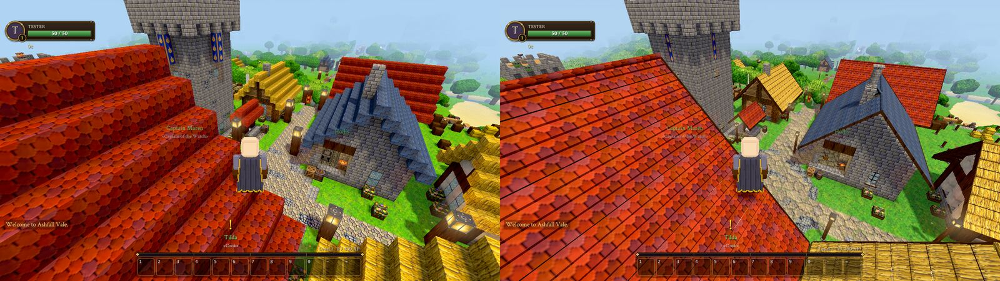

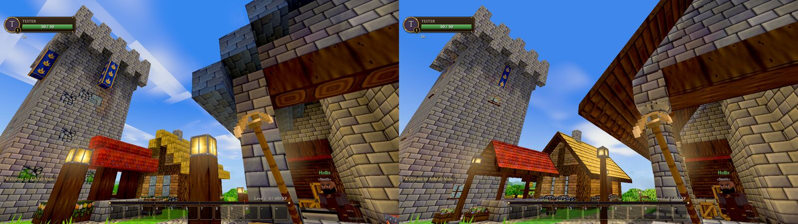

### What was built

- **Detail shapes are pack data** (`crates/dyno-client/src/shapes.rs`,
  `content/blocks.json`, `content/shapes/*.vox`). The hand-built kit
  (`detail.rs`) was baked to MagicaVoxel models at 16 voxels a block and
  deleted; each shaped block names a rule set that picks a class and turn
  from its neighbours and, per part, a model. The engine draws the voxels,
  and what it does with them is data too:
  - **slopes:** a 45° run of voxel steps of one colour becomes one sloped
    polygon (lit by its own normal, textured along the slope: a repeat per
    block of rise), merged greedily; the faces across it are cut to the
    same line and merged row by row into trapezoids, so a roof is a few
    polygons per cell, not hundreds of steps. `"slope": false` on a colour
    keeps its steps (the dark lip of each course of shingles);
  - **round parts:** `"round"` on a part draws its voxels as a solid of
    revolution with the same area slice by slice (trunks with 8 sides,
    posts, barrels, pillar shafts, the anvil's stump, the ridge roll),
    with the texture wrapped round it (`wrap`, `vscale`), smooth or flat
    sided, capped only where an end stops inside the cell;
  - **texture:** faces take their texture by place in the cell, or with
    `"uv": "fit"` on a colour stretched over that colour's bounds in the
    model (crates, hay bales, doors, the anvil, flowers);
  - **variation per place:** a class's `spin` (a trunk's twist) and
    `jitter` (props set a little askew), a part's `lift` (one flower bed's
    flowers higher than the next), all hashed from the column;
  - **joins:** a part with `"joins": true` drops its faces on the cell's
    sides where the next cell is the same block, class and turn (the
    inside of a long roof, a run of windows).
  The shapes keep the look of the old kit: roofs with shingle courses,
  eaves with fascia and rafter ends, barge boards and closed gables, ridge
  rolls; timber posts and beams; tree trunks; pillars; props; windows and
  doors; cloth awnings and tents.
- **Paving as ground.** Cobble, mossy cobble and flagstones lying flush
  with the ground join the smooth surface, so paths and the plaza blend
  into grass along a ragged painted edge.
- **Chamfered cubes.** Built cubes have their convex edges chamfered
  (5 cm), with the ends closed where a chamfer stops against a block.
- **Shading.** Texture brightness becomes painted relief (mortar and
  cracks sink, stones stand out) near the camera; built blocks get the
  same slow drift of tone as the ground, so a wall is not one stamped
  tile; softer block-corner occlusion.
- **Sky.** The noise behind the clouds uses an integer hash; the shards
  and streaks are gone.
- **Foliage and grass.** Larger leaf clumps, cool shaded undersides and
  warm crowns, slightly smaller canopies; a deeper, less yellow lawn;
  global saturation down a touch.
- **Builders.** The watchtower is dressed stone with moss only near the
  ground (no random cobble patches); the plaza rim is cobble; ruin
  masonry has no random cobble blocks.

### Rules that keep it seamless

Each section reads its blocks with a 4-block border and decides paving and
detail shapes for every cell the meshers read (-3..N+3), reading one cell
beyond. Two tests hold this: `detail_shapes_agree_across_sections` (every
shared cell is decided the same by neighbouring sections) and the existing
`sections_agree_at_their_borders` and `the_skin_has_no_holes` (run without
chamfers, which meet unchamfered blocks in T-junctions).

### Performance

Measured on a busy shared machine; the meshing numbers are per-section
best of nine runs, frame and load are medians over six shots per camera.

| | before | after |
|---|---|---|
| town section remesh, average | 0.16–0.20 ms | 0.25–0.26 ms |
| town section remesh, worst | 0.6–0.7 ms | 1.3 ms |
| whole world on all cores | 0.08–0.10 s | 0.10–0.12 s |
| `load_world` (headless shot) | 345–384 ms | 391–418 ms |
| frame (headless, 1280x720) | 3.8–4.3 ms | 4.7–5.3 ms |
| world vertices | 6.31 M | 7.80 M |

The town's sections cost about 30–50% more to mesh than before: that is
the detail geometry (about twice the town's vertices). Load and frame
time are within about 25%.

After the bake to voxels (slopes and round parts in the mesher, cleaner
roof, eave, gable, post, window and flower-bed models), measured back to
back with the pre-bake build on the town test (`town_remesh_cost`, best of
nine per section, on a loaded 16-core machine): average 0.47–0.50 ms
against 0.45–0.46 ms; worst section 1.76–1.80 ms against 1.15–1.51 ms (the
densest red roof); 1.62 M vertices against 1.36 M. The baked voxels as first
drawn, one quad per run of steps, were 0.84 ms average, 8.9 ms worst and
5.18 M vertices.

### Still to do

- Flat wall faces are still one 1 m tile; a finer, less regular stone
  pattern (or per-face stone relief geometry) would help most now.
- Tower battlements and other wall tops are plain cubes.
- Forest canopies still merge into one hedge from above; trees need
  separate crowns and some branches.
- Tables are a plank cube on a torch; counters, shelves, beds and chests
  are still cubes.
- Characters and creatures are being reworked separately.
- Collision stays on the 1 m grid (see above).

## Fine voxel terrain

The art direction is voxel (Cube World × World of Warcraft, `docs/art/README.md`),
so natural ground is no longer a smooth surface: each terrain block is drawn
as a sub-grid of fine voxels, 8 a metre near the camera. The world keeps its
1 m blocks for storage, light, physics, picking, saves and the server.

Before (left, main with the smooth ground, before its water pass) and
after (right, fine voxels with the warmer ground colours, after the water
pass), the 18 gauntlet cameras (`tools/concepts/shots.py`, `dyno shot
--stand`), same seed:

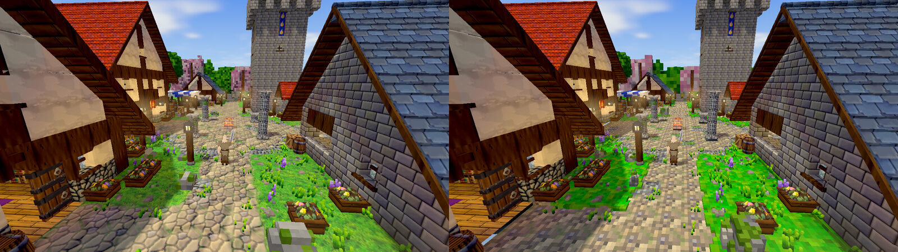
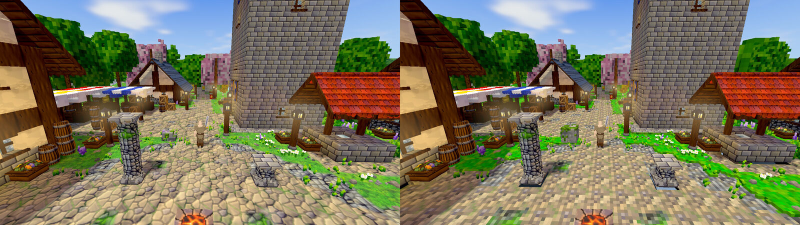
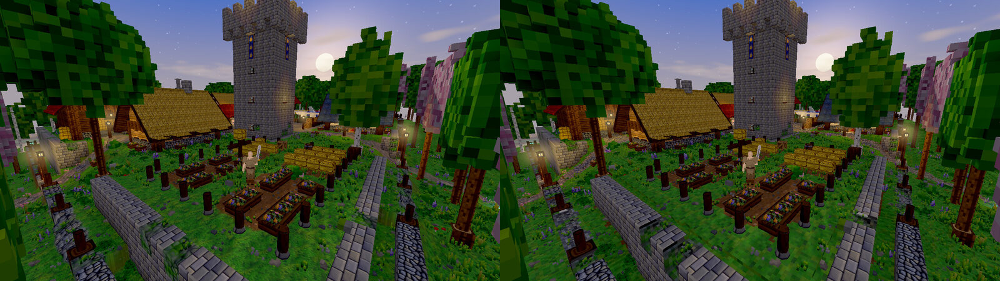
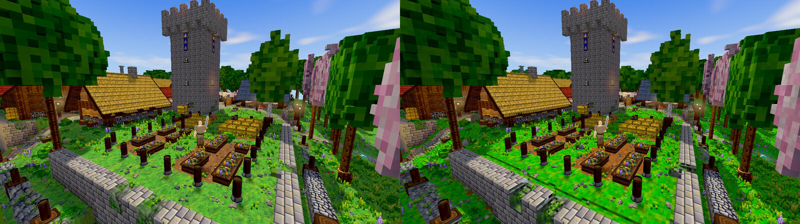
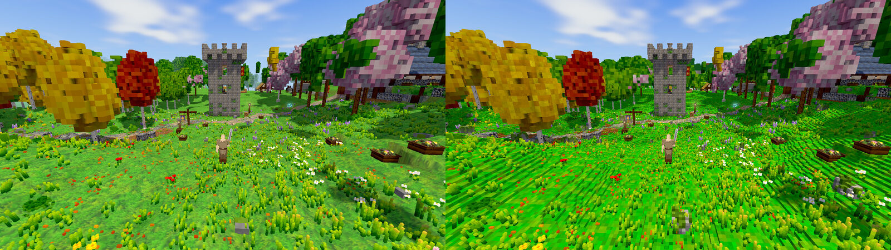
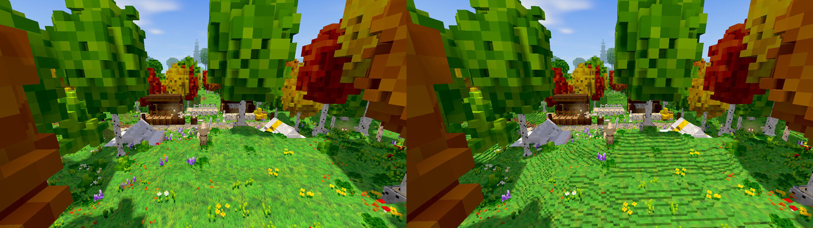
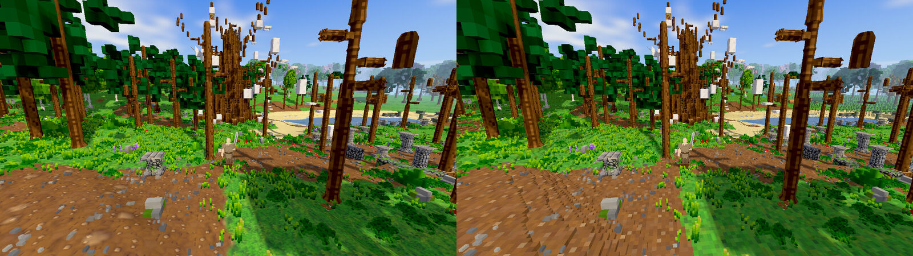
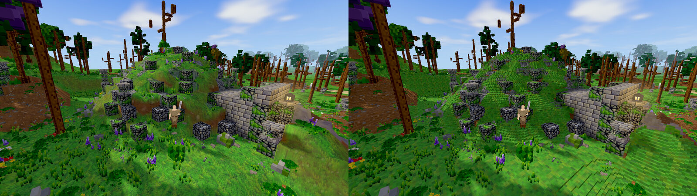
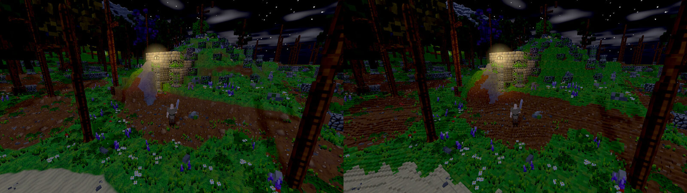
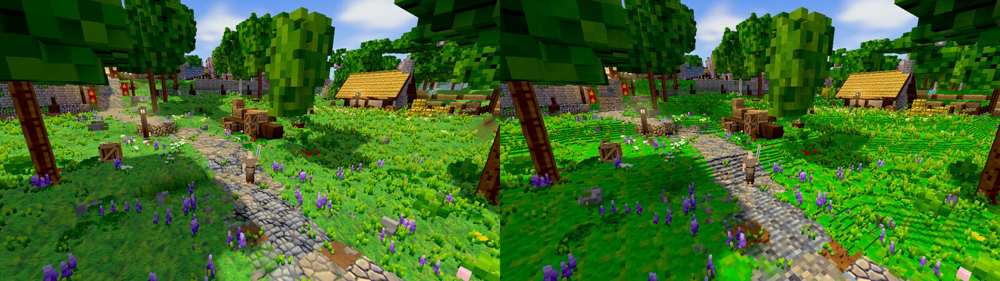
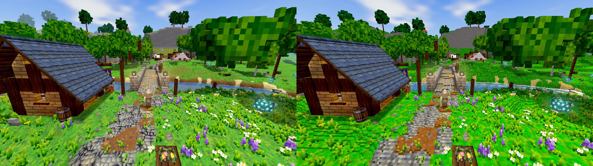
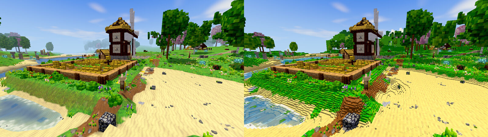
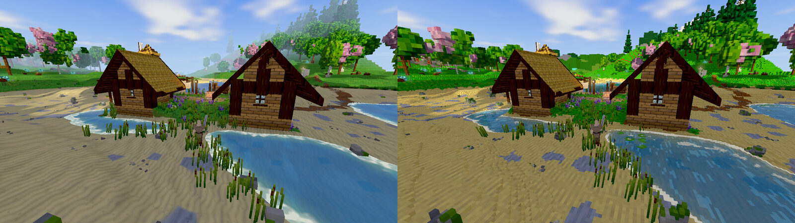
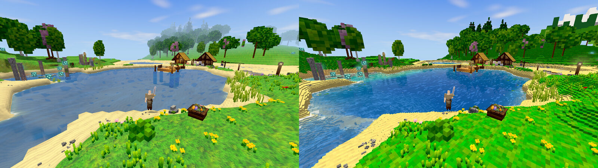
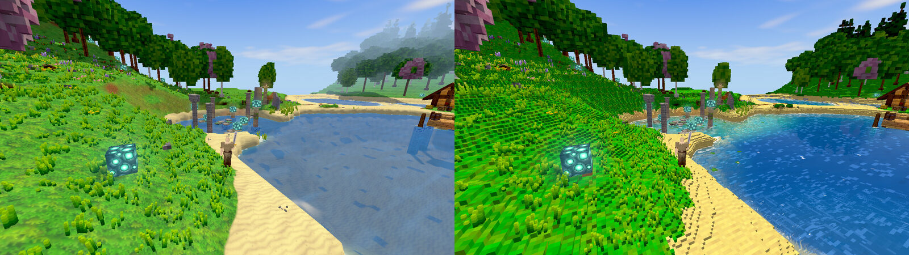
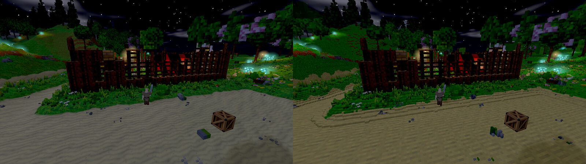
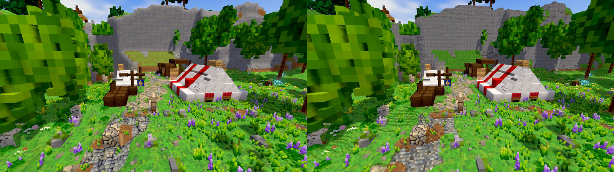
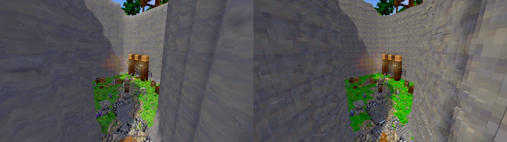

### How it works (`fine.rs`)

- **Shape.** Each ground layer is blurred over its 3 × 3 neighbourhood
  (built blocks do not count) into a field per block, positive in ground
  and negative in air. A fine voxel is solid where the field, read between
  block centres at the voxel's centre, is above zero. Level ground stays
  exactly on the block top; a one-block step becomes a stair of fine voxels
  about three blocks long; a wall two or more blocks high stays upright on
  the grid line, so cliffs keep sharp edges.
- **Raggedness.** Where a layer is mixed (ground beside air), value noise
  and horizontal strata nudge the field: banks, shorelines and slopes get
  irregular edges, cliffs get ledges. Noise stays inside a margin, so a
  block with ground all round is solid and one with none is empty; it never
  carves a slab one block thick (a roof over a cave).
- **Kinds of ground.** Where two kinds meet, each voxel takes its kind
  from a point nudged by noise, so grass meets sand and paths along a
  ragged fine-voxel edge, not a 1 m line. A block with `under` (grass over
  dirt, snow over stone) paints the voxels within `cover_depth` of open air
  and shows the other below: a grass lip over an earth bank. Paving with
  `inset` sits a voxel below the grass, column by column, so a path has a
  hard stepped edge that follows its ragged outline.
- **Colour per voxel**, in the shader: the block's texture at the voxel's
  centre on the mip level with one texel a voxel, times a hashed brightness
  and hue jitter (`jitter`), saturated (`saturation`) and tinted (`tint`)
  per block (warm golden sand, yellow-green grass, warm earth, toward the
  concepts), times the slow world tone. Geometry only knows the kind of
  ground.
- **Corner shading** (Cube World's crisp per-voxel kind; the light
  lane's screen-space occlusion handles the large scale). Each corner of a
  voxel face is darkened by how many of the three voxels round it in front
  of the face are filled (`ao`), and a top face's corner on a convex edge
  is lit (`lip`): creases where steps meet, at the foot of ledges and
  along path edges, and bright lips on steps and ledges. A corner's value
  depends only on the voxels round it, so faces that share it agree. The
  four-corner pattern is part of what faces merge on, so open level ground
  still merges whole and only one-voxel strips split off along creases and
  lips. Only within `shade_within` (24 m) of the camera. Per block
  `shade` scales it: grass at about half, rock and paving in full.
- **Gentle slopes.** On a slope (a mixed layer) each fine column reads
  the field a little above or below itself (`terrace`, `terrace_size`),
  so steps bunch in places and open into longer flat runs in others,
  instead of ruled lines; a vertical wall does not change with height, so
  cliffs are not moved. Grass and sand are lit partly by the slope the
  voxels make (`smooth`: the field's gradient, blended per vertex), so a
  meadow does not stripe into lit treads and dark risers; rock keeps its
  own faces' light. (The face's direction travels in `tex.x`, since the
  normal may be bent.)
- **Setting.** `ground_shading` (0 none, 1 creases, 2 creases and lips),
  no more than `graphics` allows (low none, medium creases).
- **Meshing.** Faces are culled against filled voxels (ground, or built
  blocks: ground touching anything another mesher draws keeps that side
  whole, so the other side's hidden face never shows), merged greedily
  within a block, then across blocks where the kind and the light are the
  same (light is blended between block corners, so faces in cells of one
  light merge exactly). Ground quads are four vertices on one shared index
  buffer. Built blocks that culled against ground still meet it cleanly;
  paving lying flush with the ground is ground.
- **Level of detail.** 8 voxels a metre within 40 m of the camera, 4 to
  64 m, 2 to 104 m, then 1 (data: `lod`). A column turns coarser only a
  little past its line. Where neighbouring columns differ, the outermost
  voxels near the surface show their sides (a skirt) so no crack opens.
  The world worker chooses the levels from its camera, the same focus that
  sets how finely leaves are drawn (`foliage.rs`): a section is meshed
  again when either its ground ring or its leaf level should change. A
  whole (not streamed) world does the same for the ground in `Gfx`.
- **Feet** stand on the top of the fine column under them
  (`terrain_mesh::Ground`); the target ring follows it too. Picking and the
  block highlight stay per block.
- **Water** is unchanged; its surface still runs on under the shore block,
  so it meets eroded banks without a gap.
- **Cover** (`cover.rs`) grows on the open, fairly level ground tops the
  mesher reports; each plant or stone is then seated on the top of the
  fine column it stands in.

All of it is data in `blocks.json` (`terrain`): voxels a metre, the levels
of detail, noise and strata strength and size, edge reach and size, cover
depth, jitter, corner shading (`ao`, `lip`, `shade_within`), step
wander (`terrace`, `terrace_size`), and per block `under`, `jitter`,
`tint`, `saturation`, `shade`, `smooth`, `edge` and `inset`. The mesher
is generic.

### Rules that keep it seamless

Every voxel is decided only from the blocks within two cells of it and its
world position, inside the section's 4-block border, so neighbouring
sections agree. Tests: `the_ground_is_a_closed_skin` (ground alone is a
closed surface of voxel faces, each drawn once, at 8, 4 and 1 a metre,
across section borders), `neighbours_decide_shared_voxels_alike`,
`sections_agree_at_their_borders` (same corner and facing, same light),
`ground_keeps_its_side_against_built_blocks`, `a_thin_roof_has_no_holes`,
`flat_ground_sits_on_the_grid`, `feet_follow_the_drawn_ground`,
`creases_are_shaded` and the
world worker's test (its meshes cover the same ground as meshing the whole
world at once).

### Performance

The 18 cameras, back to back against main on the same server and world,
headless 1280×720 debug build, on a heavily loaded 16-core machine (load
average 17–45, so times are noisy; medians):

| | main | fine voxels | ratio |
|---|---|---|---|
| world vertices (median of 18) | 6.44 M | 8.27 M | 1.28× (per shot 1.25×, worst 1.53×) |
| world complete (streamed view), two runs | 7.2 s | 6.5–7.2 s | 0.9–1.0× |
| frame, two runs | 10.8 ms | 6.7–10.2 ms | 0.6–1.0× (noise) |

Contact sheets: `visuals/terrain/contact-before.jpg`, `contact-after.jpg`.

The ground is 2.9–3.9 M of those vertices; about 60% of it is the finest
ring. Measured before the vegetation pass landed (so main's own count was
lower), three cameras came to 1.41–1.67× main's vertices.

What it took: merging across cells with uniform light (buried grid corners
borrow the light of their open neighbours, so surface cells qualify), four
vertices a quad on a shared index (a third fewer than triangle lists),
per-cell material when a cell has one kind round it, and the finest ring at
40 m (the coarse rings at 64 and 104 m). The stepped shape itself is the
cost: noise adds about 10%, ragged material edges about 1%, light classes
about 3%. Further savings if needed: an indexed or packed vertex format for
all world geometry (60 bytes a vertex today), or merging whole section
planes rather than block by block.

### Still to do

- Leaves are not part of this (the vegetation pass draws voxel clumps).
- Collision stays on the 1 m grid: feet are drawn on the fine surface, up
  to 0.7 m from where the body stands.
