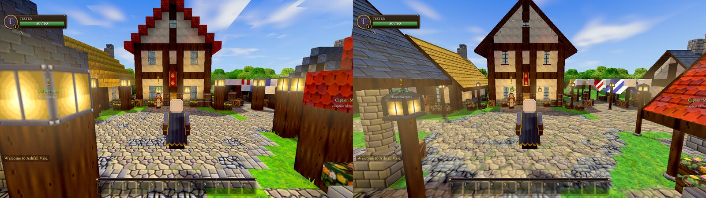
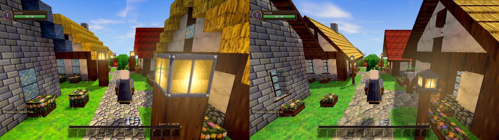
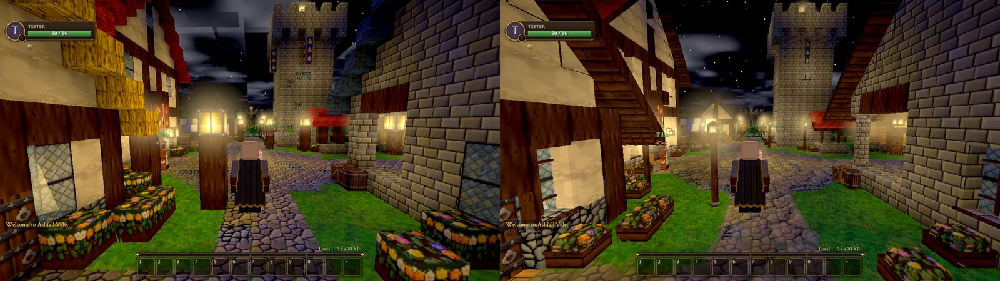
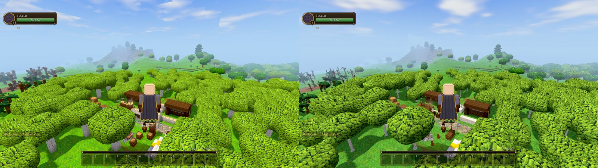

# Visuals: critique and plan

Hearthblock Online should look like a classic fantasy MMORPG: painterly,
saturated, chunky but detailed, with strong silhouettes. The world is stored
as a 1 m block grid, and too much of it is still *drawn* as that grid. This
note is an honest look at every visual element, ranked by how loudly it says
"Minecraft", and the plan for each one.

Shots for this critique were taken headless (`dyno shot … --ui hud --time
0.3 --size 1280x720`) on a fresh 384 world (seed 20261122, hearth at
[194, 37, 195]): the plaza, the main street, the inn front, the tower, an
overhead of the town, the north watch, the logging camp, the plaza at night,
a look up at the eaves and the inside of the inn.

## Ranking: what screams Minecraft (worst first)

| # | Element | Verdict | Why it reads as Minecraft |
|---|---------|---------|---------------------------|
| 1 | Roofs | **severe** | Every roof is a 45° staircase of whole 1 m cubes. The stepped outline against the sky is *the* Minecraft silhouette, and the gable ends are staircases of plaster. Tiles are painted one tile per block, so each step shows one giant row of shingles. No eaves, ridge or fascia. |
| 2 | Lamp posts and lanterns | **severe** | A 1 m square timber column with a 1 m glowing glass cube on top. At eye level the lantern is the size of a person's torso. |
| 3 | Free-standing pillars | **severe** | The plaza's cobble columns (and the beacon pillars at quest sites) are 1 m square cobble stacks with a mossy block on top. No base, no capital, no taper. |
| 4 | Timber framing | high | Corner posts, studs and beams are each a whole 1 m block, so a half-timbered house is a checkerboard of 1 m squares: the beams are as wide as the plaster panels. Fences, stall posts and paddock rails are 1 m blocks too. |
| 5 | Props | high | Barrels, crates, hay bales, flower boxes, braziers, anvils, bookshelves are textured 1 m cubes. A crate is a cube with a crate painted on; a flower bed is a cube of flowers. |
| 6 | Tree trunks | high | Oak and birch trunks are 1 m square columns under the soft canopies, so every tree is a puffball on a square post. |
| 7 | Banners | high | Banners are 1 m thick cloth cubes, sometimes two stacked: the emblem is huge pixel art and the "cloth" has depth like a wall. |
| 8 | Windows and doors | medium-high | A leaded window is a flat translucent cube face; a door is two flat textured cubes. No frame depth, no sill, no mullions, no ironwork. |
| 9 | Stone walls | medium | Stone bricks and cobble are flat-faced cubes with a 1 m tile; corners are knife-sharp; the tile repeats on every block, so a wall is a grid. |
| 10 | Paths and the plaza | medium | Cobble and flagstones are cubes level with the ground: the grass meets them on hard, straight block edges, and the smooth ground is pinned to the grid wherever a path touches it. |
| 11 | Clouds | medium | The painted clouds break into hard-edged shards and streaks near the zenith (the noise lookup wraps), which looks like a glitch, not like paint. |
| 12 | Leaf canopies | low-medium | Already smooth and puffy (good), but the leaf texture is a big repeated scale pattern in a very yellow lime, so canopies read like topiary hedges. |
| 13 | Terrain | low | Surface nets give soft hills. Remaining tells: terrace lines on cliffs, sand and dirt patches in squares where the blend is weak. |
| 14 | Water | low | Lowered surface, foam and swell are good. The flat plane and the shore edge are fine at a distance. |
| 15 | Lighting | low | Sun shadows, sky ambient and a warm grade work. The cube mesher's vertex AO gives the classic four-step Minecraft corner darkening on built blocks; there is no ambient occlusion on anything finer than a block. |
| 16 | Fog and sky colour | low | Good aerial perspective; the horizon haze is a little bright and flat at midday. |
| 17 | Colour grade | low | Warm and saturated, close to the target. Grass is a little too neon. |
| 18 | Nameplates, rings, halos | low | Nameplates and quest marks are clean and in style; lamp halos help. |
| — | Characters and creatures | n/a | Being reworked separately (not part of this pass). |

## Element by element

**Roofs.** The single biggest tell. Plan: roof blocks become *detail
blocks*: their slope direction is inferred from the roof block diagonally
above or below, and each roof cell is drawn as a straight sloped slab (cutting
the cell on its diagonal) so a whole roof side becomes one plane. The eave
cell overhangs past the wall and gets a fascia board; the top gets a ridge
cap; the gable ends are closed with a wedge of the gable wall's material;
each slab carries shingle courses as small stepped strips, so the tiles are
about 25 cm, not 1 m. The underside is drawn too (rafters seen from inside).

**Timber.** Timber, logs and planks used as building parts are split by
what is around them: a free-standing column becomes a slim chamfered post
(30 cm) with a foot and a cap; a run between posts becomes a rail; a beam in
a wall stays a full cell (the wall must stay closed) but stands proud of the
plaster with chamfered edges, so a half-timbered wall gets real relief.

**Stone.** Free-standing stone columns become round-ish (octagonal)
pillars with a plinth at the foot and a capital at the head. Wall corners get
bevels. Flat walls get finer relief from shading rather than geometry, to
keep the vertex budget sane.

**Props.** Each prop block gets a hand-built mesh: barrels with staves and
hoops, crates with a frame and slats, lanterns as small iron lanterns with a
glowing core (on a post bracket or hanging), braziers as a bowl on legs,
anvils, hay bales with rounded edges, flower boxes as planters with clumps,
banners as thin hanging cloth on a rod, doors with planks and iron straps,
windows with frames, sills and mullions.

**Paths.** Cobble, mossy cobble and flagstones that lie on the ground (solid
below, open above, ground beside) are drawn as part of the smooth ground, so
they use the terrain shader's ragged painted edge to blend into grass and
follow the ground instead of standing on the grid.

**Sky.** Fix the cloud lookup so clouds are soft billows everywhere.

**Global.** Fine-geometry ambient occlusion from the blocks around each
vertex; a slightly less neon grass; canopy leaf scale.

## How detail blocks work

The world keeps its 1 m grid for storage, light, physics and saves. Meshing
reads each section plus a 3-block border; for a *detail block* the mesher
emits a small hand-built mesh in place of the cube, chosen by the block and
its neighbours (auto-connect). Rules:

- Detail blocks still block light and stay solid for collision; the client
  mesher no longer lets them hide their neighbours' faces, so walls behind
  a barrel or under an eave are drawn.
- A detail mesh takes its light from the open cells around it (the cell
  itself is dark, being opaque to light), and its AO from the solid cells
  around each vertex.
- Shape choices read only blocks within the section border, so two sections
  always agree and borders stay seamless.
- Geometry is spent on silhouettes (roofs, posts, pillars, props, frames),
  not on flat wall faces.

## Known mismatches

Collision stays on the 1 m grid: a roof slab sits half a block below the
top of its cell, posts and barrels are thinner than the cube you bump into,
and a sloped roof is walked as stairs. Inside towns players rarely touch
these; the drawn ground on paths can sit a few centimetres off the grid at
edges.

## Results

Before (left) and after (right), same cameras, fresh worlds from the same
seed:

### What was built

- **Detail mesher** (`crates/dyno-client/src/detail.rs`). A small kit of
  boxes, bevelled boxes, solids of revolution and free polygons, in a
  per-block frame that can be turned, with light and occlusion blended
  from the cells round each vertex. Shapes:
  - roofs: straight slopes, four shingle courses a block (two for thatch),
    eaves reaching a third of a block past the wall with fascia boards and
    rafter ends, ridge caps or a ridge roll, barge boards and closed ends
    at the gables, a planked underside, and the gable wall carried up under
    the slope;
  - timber: proud beams in walls (the wall stays closed), slim chamfered
    posts on stone footings with caps, fence rails, beams over gates;
  - round tree trunks with root flare that thin into the canopy;
  - stone pillars with plinth, swelling shaft and capital (also the quest
    beacons);
  - barrels, crates, hay bales with twine, an anvil on a stump, a brazier
    on legs with glowing coals, flower boxes, lanterns (on posts, hanging,
    or on wall brackets), thin banners with rods and swallowtails, windows
    with jambs, mullions, sills and glass, plank doors with iron straps;
  - cloth: awnings sag between their posts with scalloped flaps; tents
    slope like roofs.
- **Paving as ground.** Cobble, mossy cobble and flagstones lying flush
  with the ground join the smooth surface, so paths and the plaza blend
  into grass along a ragged painted edge.
- **Chamfered cubes.** Built cubes have their convex edges chamfered
  (5 cm), with the ends closed where a chamfer stops against a block.
- **Shading.** Texture brightness becomes painted relief (mortar and
  cracks sink, stones stand out) near the camera; built blocks get the
  same slow drift of tone as the ground, so a wall is not one stamped
  tile; softer block-corner occlusion.
- **Sky.** The noise behind the clouds uses an integer hash; the shards
  and streaks are gone.
- **Foliage and grass.** Larger leaf clumps, cool shaded undersides and
  warm crowns, slightly smaller canopies; a deeper, less yellow lawn;
  global saturation down a touch.
- **Builders.** The watchtower is dressed stone with moss only near the
  ground (no random cobble patches); the plaza rim is cobble; ruin
  masonry has no random cobble blocks.

### Rules that keep it seamless

Each section reads its blocks with a 4-block border and decides paving and
detail shapes for every cell the meshers read (-3..N+3), reading one cell
beyond. Two tests hold this: `detail_shapes_agree_across_sections` (every
shared cell is decided the same by neighbouring sections) and the existing
`sections_agree_at_their_borders` and `the_skin_has_no_holes` (run without
chamfers, which meet unchamfered blocks in T-junctions).

### Performance

Measured on a busy shared machine; the meshing numbers are per-section
best of nine runs, frame and load are medians over six shots per camera.

| | before | after |
|---|---|---|
| town section remesh, average | 0.16–0.20 ms | 0.25–0.26 ms |
| town section remesh, worst | 0.6–0.7 ms | 1.3 ms |
| whole world on all cores | 0.08–0.10 s | 0.10–0.12 s |
| `load_world` (headless shot) | 345–384 ms | 391–418 ms |
| frame (headless, 1280x720) | 3.8–4.3 ms | 4.7–5.3 ms |
| world vertices | 6.31 M | 7.80 M |

The town's sections cost about 30–50% more to mesh than before: that is
the detail geometry (about twice the town's vertices). Load and frame
time are within about 25%.

### Still to do

- Flat wall faces are still one 1 m tile; a finer, less regular stone
  pattern (or per-face stone relief geometry) would help most now.
- Tower battlements and other wall tops are plain cubes.
- Forest canopies still merge into one hedge from above; trees need
  separate crowns and some branches.
- Tables are a plank cube on a torch; counters, shelves, beds and chests
  are still cubes.
- Characters and creatures are being reworked separately.
- Collision stays on the 1 m grid (see above).
