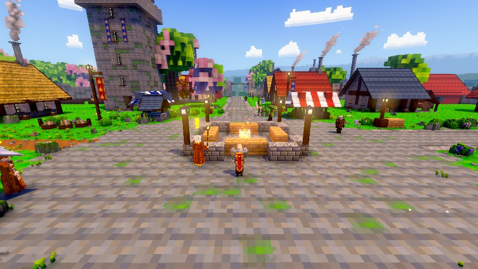

# The first 30 minutes, round 2

24 November 2026. Sections 3 to 5 and 12 of
[the quality bar](../design/quality-bar.md). Round 1 is
[first-30-minutes-2026-11-23.md](first-30-minutes-2026-11-23.md) and
[fun-review-2026-11-23.md](fun-review-2026-11-23.md); this round measures
what it left, attributes every death, and changes what the tables asked for.

## The goals, and where each stands

| | Goal | Result |
|---|---|---|
| 1 | A like-for-like baseline on main: one bot build, two 12-bot 30-minute mixed swarms, tick p95 under 50 ms, medians per player type and class | **Pass.** Bot build `2b98591`, runs A and B on main `60a0d69`, tick p95 1.00 and 1.25 ms at load 6.6 and 8.3 on 16 cores. Tables below |
| 2 | Every death attributed; completionist, casual, explorer and social under 1.5 deaths an hour each; no night deaths at levels 1 to 4 on roads or in quest areas | **Attributed: pass. Rates: fail.** Deaths an hour, completionist / casual / explorer / social: 2.5 / 3.0 / 2.0 / 2.0 before; 1.8 / 0 / 4.0 / 2.0 after with the bots kept off the group elite; on the rules as shipped the bots walk into Old Tusk alone and completionists die 11.5 times an hour (15 of 23 deaths). Deaths to Shades at levels 1 to 4 on a road or in a quest area: 5 before, all at the town gate; 1 after, a level 4 explorer who attacked a Shade in the Forgotten Graves at 9% health. Any death at night there: 6 before, 4 after. Grinders: the bot brain (28 of 35 deaths are pulls at under 60% health, no adds) |
| 3 | Completionist, casual and social travel 50% of their time or less; the five longest runs fixed by moving content | **Fail.** Completionist 68% to 66%, casual 65% to 60%, social 68% to 74% (elite hidden). Four of the five longest runs were the 650 m walk to Anwen and are gone; a completionist's travel per quest fell from 1.35 to 1.11 minutes and it finishes 18.5 quests, not 15; but what the bots save they spend walking to the next hub |
| 4 | Longest reward gap: median under 2:00, worst under 3:30; every gap over 2:00 listed with its cause | **Fail.** Median longest gap 2:46 to 2:25 (questing bots alone: 2:52 to 2:04); gaps over 2:00, 35 to 23. The worst went from 7:30 (waiting for Old Tusk, fixed) to 15:48: a warrior bot swapping a two-handed axe and a buckler for ever, a bot fault that main's build shows too; the next worst among the questing bots is 3:12 |
| 5 | Old Tusk falls to three and not to one level 4; all five cart drop-offs ridden; two 30-minute hand runs on the final build | **Pass, with one caveat.** Old Tusk, after changing him: on main a geared level 4 warrior or priest killed him alone. Now 0 of 9 solo attempts, a three in 10 s, a pair in 17 s. Five drop-offs ridden. Two 30-minute hand runs (mage, rogue), no deaths; they ran on `ca3d71f`, which is this branch merged with main but before its last merge and the thieves' creature |
| 6 | Shared tags: a crowd at one camp no longer starves | **Pass.** Kills lost to another player's tag, 12 bots on the gate flocks: 26% to 0% (17% to 2% in the mixed swarms). Meat for the Pot done at 2:21, was 3:39 |
| 7 | Enough quest content to reach level 5 by 30 minutes without grinding | **Yes.** Level 5 needs 4,800 XP; quests of level 5 and under that need neither night nor a group pay 7,320, their kills about 1,750 more. 5 of 8 completionist bots reached level 5 by minute 30 after the changes (1 of 8 before), and they fight only what a quest asks for |

Also asked for during the round: a new character wakes facing the hearth
and the first quest giver with his "!" in view. **Done**, on top of world
round 3's wake point ([picture](runs/r2-wake-view.jpg)).

## How it was measured

- **One bot build for every counted swarm:** `2b98591` (`crates/dyno-bot/src`
  is unchanged from there to the last counted run). Against round 1's bots
  it adds measurement (each fight's start with health and what stood near,
  each death's surroundings, unbroken stretches of travel, a 5-second trail)
  and two behaviours, both in the baseline too: a bot takes a cart to a hub
  it has walked to when that saves 200 m, and at night looks for Shades in
  a place the rules mark as the dark's (there are none on main, so there it
  does what it did).
- **Before:** two swarms, `dyno bots --local --port 7710 --count 12 --minutes 30`,
  on main's rules (`60a0d69`).
- **After, first pass:** one swarm on the first set of changes (`0ef9486`).
  It showed two things that swamped everything else (below), so it is
  reported but not pooled.
- **After:** two swarms on the final rules of this branch as they stood
  before merging main (the same engine and classes as the baseline), with
  one difference from what ships: Old Tusk's kind is marked level 8 in the
  rules file the server was given, so the bots, which skip creatures four
  levels above them and cannot read "(Group)", leave him alone. His camp
  still sets his real level; players see no difference. Why: next section.
- **Tick and load** are printed beside each table. A `--local` swarm now
  records the server's tick cost itself (mean, p95, p99, worst, and the
  worst minute's p95) and `/proc/loadavg` each minute; for a swarm against a
  separate server, `DYNO_TICK_STATS=1` logs the p95 each minute and
  `tools/playtest/attach_tick.py` puts it in the report.
- **Analysis:** `tools/playtest/round2.py --rules RULES REPORT...`. The bots
  record facts; the script decides what they mean, with the rules the run
  was made on. Definitions: *on a road* is within 10 m of a road or trail
  of the layout; *in a quest area* is within 45 m of a camp of a creature
  that a quest of level 5 or under asks for, in an explore objective's
  circle, by a quest ore place, or in a safe hub; *engaged* is every
  creature within 6 m at the death that is hostile or that the bot had hit.
  A death's cause is the first that fits of: *over-level* (the killer two or
  more levels above), *night* (a Shade), *adds* (two or more engaged),
  *jumped* (attacked while under 60% health), *low pull* (the bot chose to
  pull under 60% health), *one-on-one*.
- **Small samples.** A 12-bot mix has one casual, one explorer and one
  social bot, and the casual one plays 5 to 15 minutes. One death there
  reads as 2 to 6 an hour. Counts and bot-hours are shown; rates are pooled
  over both runs.
- **Hand play** through `dyno play`, driven command by command.

## What the first pass taught

The first set of changes made Old Tusk a real elite (he could be soloed on
main) and fixed a rule that had hidden him: a creature could not come back
within 12 m of a player, so one bot waiting in his hollow kept him from
ever returning. With both fixed, he was always there and never soloable,
and the bots, which take every quest and cannot read "(Group)", walked into
him alone one after another: 21 of that run's 49 deaths, and 18 bot-minutes
of walking back from the hearth to die again, the largest single use of
travel time. The second thing: Thieves in the Fields counts any Ashcloak,
and from the hearth the level 5 scouts on the East Road are nearer than the
new camp in Ostrin's field, so bots went there and died (5 deaths).

| First pass, one run (12 bots, 30 min; tick p95 1.00 ms, load 7.5) | completionist | social | explorer |
|---|---|---|---|
| Deaths | 23, of which 15 to Old Tusk alone and 5 at Ashcloak camps | 4, of which 2 to Old Tusk | 1, to Old Tusk |
| Travel | 71% | 65% | 81% |

The thieves were fixed in the rules (they are their own creature now, in
Ostrin's east field only). Old Tusk is right for players and wrong only for
bots that cannot read, so for the counted after runs the bots are kept off
him and he is tested on his own (below). The bot should learn to leave
group quests alone unless it is in a party; that is a change to the bot
build, so it is for the next round.

## 1. The baseline on main

| | run | report | load: start / mean / max (cores) | server tick: mean / p95 / p99 / worst | worst minute's p95 | counts (p95 < 50 ms) |
|---|---|---|---|---|---|---|
| before | A | r2-before-a-mix-12x30.json.gz | 5.6 / 6.6 / 17.4 (16) | 0.45 / 1.00 / 2.50 / 67 ms | 2.75 ms | yes |
| before | B | r2-before-b-mix-12x30.json.gz | 10.3 / 8.3 / 16.2 (16) | 0.47 / 1.25 / 2.75 / 58 ms | 1.75 ms | yes |
| after, first pass | - | r2-after1-mix-12x30.json.gz | 11.3 / 7.5 / 16.8 (16) | 0.42 / 1.00 / 2.00 / 127 ms | 1.75 ms | yes |
| after (elite hidden) | A | r2-after2-a-mix-12x30.json.gz | 10.3 / 10.4 / 17.9 (16) | 0.47 / under 1.75 / not measured / 34 ms | 1.75 ms | yes |
| after (elite hidden) | B | r2-after2-b-mix-12x30.json.gz | 15.7 / 14.1 / 27.9 (16) | 0.54 / under 3.00 / not measured / 31 ms | 3.00 ms | yes |

### Per player type, before and after

"Before" is the two baseline runs on main; "after" is the two runs on the
final rules with Old Tusk hidden from the bots (see above). Medians over
the bots of both runs; deaths an hour are deaths over the hours played,
pooled. "Kills lost to a tag" went to another player's tag with another
player within 20 m. Time shares are of the time played.

| brain | | bots | level 2 | level 3 | level 4 | level at end | reached 5 | quests done | XP earned | longest gap (median) | longest gap (worst) | travel | fighting | waiting for spawns | deaths | deaths an hour | kills lost to a tag |
|---|---|---|---|---|---|---|---|---|---|---|---|---|---|---|---|---|---|
| completionist | before | 8 | 2:47 | 9:02 | 16:04 | 4 | 1 of 8 | 15 | 4010 | 3:33 | 7:30 | 68% | 14% | 12% | 10 in 4.00 h | 2.5 | 17% |
|  | after | 8 | 2:18 | 8:10 | 15:09 | 5 | 5 of 8 | 18.5 | 4947 | 2:35 | 15:48 | 66% | 19% | 1% | 7 in 4.00 h | 1.8 | 1% |
| casual | before | 2 | 3:25 | 11:19 | - | 3 | 0 of 2 | 8.5 | 2020 | 1:19 | 1:36 | 65% | 21% | 0% | 1 in 0.34 h | 3.0 | 0% |
|  | after | 2 | 2:50 | - | - | 2.5 | 0 of 2 | 6 | 1130 | 0:40 | 0:44 | 60% | 24% | 0% | 0 in 0.22 h | 0.0 | 0% |
| explorer | before | 2 | 4:39 | 11:22 | 21:01 | 4 | 0 of 2 | 13 | 3552 | 2:38 | 3:03 | 82% | 12% | 0% | 2 in 1.00 h | 2.0 | 7% |
|  | after | 2 | 4:06 | 10:10 | 23:51 | 4 | 0 of 2 | 13.5 | 3426 | 1:46 | 1:47 | 77% | 16% | 0% | 4 in 1.00 h | 4.0 | 2% |
| social | before | 2 | 2:53 | 8:56 | 17:46 | 4.5 | 1 of 2 | 17.5 | 4743 | 2:14 | 2:56 | 68% | 19% | 4% | 2 in 1.00 h | 2.0 | 21% |
|  | after | 2 | 2:17 | 8:42 | 16:01 | 4 | 0 of 2 | 17.5 | 4469 | 2:18 | 2:27 | 74% | 18% | 0% | 2 in 1.00 h | 2.0 | 1% |
| party | before | 4 | 2:21 | 8:52 | 18:13 | 4 | 0 of 4 | 13 | 3065 | 3:54 | 5:05 | 73% | 7% | 4% | 0 in 2.00 h | 0.0 | 2% |
|  | after | 4 | 2:25 | 16:44 | - | 3 | 0 of 4 | 11 | 2244 | 8:02 | 15:41 | 47% | 7% | 0% | 0 in 2.00 h | 0.0 | 0% |
| grinder | before | 6 | 2:58 | 8:13 | 18:43 | 4 | 0 of 6 | 2 | 3537 | 2:09 | 6:19 | 24% | 66% | 0% | 35 in 3.00 h | 11.7 | 20% |
|  | after | 6 | 2:15 | 7:17 | 17:15 | 4 | 0 of 6 | 2 | 3670 | 2:07 | 5:05 | 25% | 64% | 0% | 32 in 3.00 h | 10.7 | 3% |
| all | before | 24 | 2:51 | 8:59 | 17:22 | 4 | 2 of 24 | 13.5 | 3604 | 2:46 | 7:30 | 59% | 27% | 5% | 50 in 11.34 h | 4.4 | 17% |
|  | after | 24 | 2:24 | 8:29 | 16:08 | 4 | 5 of 24 | 13 | 3689 | 2:25 | 15:48 | 54% | 29% | 1% | 45 in 11.21 h | 4.0 | 2% |

### Per class, before and after

| class | | bots | level 2 | level 3 | level 4 | level at end | reached 5 | quests done | XP earned | longest gap (median) | longest gap (worst) | travel | fighting | waiting for spawns | deaths | deaths an hour | kills lost to a tag |
|---|---|---|---|---|---|---|---|---|---|---|---|---|---|---|---|---|---|
| Hunter | before | 4 | 3:26 | 10:08 | 21:01 | 4 | 0 of 4 | 12.5 | 3164 | 2:54 | 5:03 | 77% | 12% | 4% | 2 in 2.00 h | 1.0 | 5% |
|  | after | 4 | 3:07 | 10:10 | 24:15 | 4 | 0 of 4 | 13 | 3198 | 3:10 | 10:52 | 63% | 13% | 0% | 4 in 2.00 h | 2.0 | 1% |
| Mage | before | 4 | 3:21 | 9:38 | - | 3.5 | 0 of 4 | 5 | 2769 | 1:29 | 6:11 | 38% | 47% | 0% | 11 in 1.34 h | 8.2 | 11% |
|  | after | 4 | 2:50 | 7:25 | - | 3.5 | 0 of 4 | 3 | 2495 | 1:50 | 3:11 | 40% | 46% | 0% | 6 in 1.22 h | 4.9 | 2% |
| Paladin | before | 4 | 2:32 | 8:09 | 19:02 | 4 | 0 of 4 | 2 | 3490 | 2:09 | 6:19 | 22% | 71% | 0% | 25 in 2.00 h | 12.5 | 23% |
|  | after | 4 | 2:06 | 7:18 | 17:42 | 4 | 0 of 4 | 2 | 3693 | 1:16 | 5:05 | 20% | 71% | 0% | 26 in 2.00 h | 13.0 | 3% |
| Priest | before | 4 | 3:15 | 9:08 | 15:38 | 4 | 1 of 4 | 15 | 4240 | 2:37 | 4:35 | 65% | 16% | 9% | 3 in 2.00 h | 1.5 | 21% |
|  | after | 4 | 2:17 | 8:42 | 15:40 | 4 | 1 of 4 | 18 | 4492 | 2:18 | 2:52 | 73% | 18% | 1% | 2 in 2.00 h | 1.0 | 1% |
| Rogue | before | 4 | 2:21 | 8:15 | 17:16 | 4 | 0 of 4 | 14.5 | 3596 | 4:09 | 7:30 | 74% | 8% | 5% | 3 in 2.00 h | 1.5 | 9% |
|  | after | 4 | 2:27 | 10:29 | - | 3.5 | 1 of 4 | 13 | 3264 | 3:36 | 15:41 | 60% | 10% | 0% | 1 in 2.00 h | 0.5 | 0% |
| Warrior | before | 4 | 2:47 | 9:15 | 16:37 | 4 | 1 of 4 | 15.5 | 4105 | 3:20 | 4:17 | 68% | 16% | 11% | 6 in 2.00 h | 3.0 | 17% |
|  | after | 4 | 2:23 | 8:09 | 15:37 | 5 | 3 of 4 | 19 | 4984 | 2:59 | 15:48 | 59% | 21% | 1% | 6 in 2.00 h | 3.0 | 2% |
| all | before | 24 | 2:51 | 8:59 | 17:22 | 4 | 2 of 24 | 13.5 | 3604 | 2:46 | 7:30 | 59% | 27% | 5% | 50 in 11.34 h | 4.4 | 17% |
|  | after | 24 | 2:24 | 8:29 | 16:08 | 4 | 5 of 24 | 13 | 3689 | 2:25 | 15:48 | 54% | 29% | 1% | 45 in 11.21 h | 4.0 | 2% |

The two classes that die most, Paladin and Mage, are the classes of the
grinder bots (bots 1, 7 and 11 of every 12): those rows are the brain, not
the class. See section 2. The party pair got worse after, and not from
anything in the rules: one of the two stood idle for 15:41 of run A and
10:52 of run B (the party brain stalls; it did for 5:05 in the baseline).

## 2. Every death, before anything was changed

The 50 deaths of the two baseline runs, each with its killer and level gap,
what was engaged, day or night, health at the pull, and where:
[runs/r2-before-analysis.md](runs/r2-before-analysis.md). The 15 that were
not grinders:

| run | bot | brain | class | at | lv | killer (gap) | engaged at death | day/night | health at pull | pulled | where | quest area | road | cause |
|---|---|---|---|---|---|---|---|---|---|---|---|---|---|---|
| A | 06com | completionist | Warrior | 11:15 | 3 | Shade 1 (-2) | Shade 1×3, Shade 2×2 | night | 9% | Shade 2 (attacked) | Hearthstead | Hearthstead | yes | night |
| A | 03com | completionist | Rogue | 18:59 | 3 | Ashcloak Bandit 4 (+1) | Ashcloak Bandit 4×2 | day | 79% | Ashcloak Bandit 4 | mere_ashcloaks | ashcloak camp | no | adds |
| A | 00com | completionist | Warrior | 23:45 | 4 | Thornboar 3 (-1) | Thornboar 3 | day | 16% | Thornboar 3 (attacked) | 30 m from logging_trail_well_14 | thornboar camp | no | jumped |
| B | 00com | completionist | Warrior | 9:09 | 2 | Thornboar 2 (+0) | Thornboar 2 | day | 11% | Thornboar 2 | 50 m from logging_trail_well_14 | thornboar camp | no | low pull |
| B | 00com | completionist | Warrior | 11:05 | 3 | Shade 1 (-2) | Shade 1×4, Shade 2×4 | night | 100% | Shade 2 | 87 m from Hearthstead | outside | yes | night |
| B | 06com | completionist | Warrior | 11:19 | 3 | Shade 2 (-1) | Shade 2 | night | 0% | Shade 2 | 95 m from Hearthstead | grazer camp | no | night |
| B | 03com | completionist | Rogue | 11:42 | 3 | Shade 2 (-1) | Shade 2×2, Shade 1×3 | night | 29% | Shade 2 (attacked) | Hearthstead | Hearthstead | yes | night |
| B | 10com | completionist | Priest | 18:38 | 4 | Barrow Warden 6 (+2) | Barrow Warden 6 | day | 61% | Barrow Warden 6 (attacked) | The Old Barrow | into_barrowwood | no | over-level |
| B | 00com | completionist | Warrior | 19:17 | 4 | Barrow Warden 6 (+2) | Barrow Warden 6 | day | 79% | Barrow Warden 6 (attacked) | The Old Barrow | into_barrowwood | no | over-level |
| B | 03com | completionist | Rogue | 20:59 | 4 | Old Tusk 4 (+0) | Old Tusk 4 | day | 100% | Old Tusk 4 | 74 m from logging_trail_cairn_15 | old_tusk camp | no | one-on-one |
| B | 05cas | casual | Mage | 10:14 | 2 | Shade 2 (+0) | Shade 2×2 | night | 11% | Shade 2 (attacked) | 68 m from Hearthstead | Hearthstead | yes | night |
| A | 02exp | explorer | Hunter | 23:03 | 4 | Websnare 4 (+0) | Websnare 4 | day | 29% | Websnare 4 (attacked) | The Barrowwood Graves | forgotten_graves | no | jumped |
| A | 02exp | explorer | Hunter | 27:52 | 4 | Ashcloak Bandit 4 (+0) | Ashcloak Bandit 4 | night | 4% | Ashcloak Bandit 4 (attacked) | mere_ashcloaks | ashcloak camp | no | jumped |
| A | 04soc | social | Priest | 16:17 | 3 | Ashcloak Bandit 3 (+0) | Ashcloak Bandit 3 | day | 100% | Ashcloak Bandit 3 | mere_ashcloaks | ashcloak camp | no | one-on-one |
| B | 04soc | social | Priest | 19:57 | 4 | Barrow Warden 6 (+2) | Barrow Warden 6 | day | 61% | Barrow Warden 6 (attacked) | The Old Barrow | into_barrowwood | no | over-level |

| brain | bot-hours | deaths | per hour | over-level | night | adds | jumped | low pull | one-on-one | deaths at night at level 1-4 on a road or in a quest area | of those, to a Shade |
|---|---|---|---|---|---|---|---|---|---|---|---|
| completionist | 4.00 | 10 | 2.5 | 2 | 4 | 1 | 1 | 1 | 1 | 4 | 4 |
| casual | 0.34 | 1 | 3.0 | 0 | 1 | 0 | 0 | 0 | 0 | 1 | 1 |
| explorer | 1.00 | 2 | 2.0 | 0 | 0 | 0 | 2 | 0 | 0 | 1 | 0 |
| social | 1.00 | 2 | 2.0 | 1 | 0 | 0 | 0 | 0 | 1 | 0 | 0 |
| party | 2.00 | 0 | 0.0 | 0 | 0 | 0 | 0 | 0 | 0 | 0 | 0 |
| grinder | 3.00 | 35 | 11.7 | 0 | 6 | 0 | 1 | 28 | 0 | 11 | 5 |
| all | 11.34 | 50 | 4.4 | 3 | 11 | 1 | 4 | 29 | 2 | 17 | 10 |

What the table said, and what was done about each:

- **The night at the gate (5 of the 15, and all 5 of the night deaths on a
  road at levels 2 and 3).** The Nightfall Incursion puts 3 to 9 Shades 8 m
  outside a gate of Hearthstead, which is the road between the first quest
  givers and the first flocks, and they march into the town. One warrior
  died with eight on him. By hand, a level 6 walking out of the north gate
  at dusk was at 33 of 75 health before the second wave. Outside the
  incursion, a Shade rose round every player every 20 s anywhere dark.
  *Mine. Changed:* Shades rise only in the dark's haunts, and leave
  characters under level 5 alone until struck.
- **Over-level (3): the Barrow Warden.** A level 6 elite under the Old
  Barrow who saw through its roof. Anwen, who offers a quest to anyone of
  level 4, stands 9 m from him above ground. *Mine. Changed:* his sight is
  3 m, and Anwen's quest now follows Garrick's.
- **Adds and jumped (4): Ashcloaks at the mere, a Websnare at the graves, a
  boar by the logging trail.** The five Ashcloaks stood in a 14 m knot, so
  two came at once; the boar pack round 1 put "80 m from Holt" stood on the
  logging trail, the road of the level 3 quest Garrick's Camp. *Mine.
  Changed:* the camp is spread out, the thieves have their own camp in
  Ostrin's field, the boars are off the trail.
- **One-on-one at the same level (2), for the class lane:** a level 3
  priest at full health lost to a level 3 Ashcloak Bandit; a level 4 rogue
  at full health lost to Old Tusk (as designed: he is a group quest).
- **Low pull (1):** a warrior pulled a boar at 11% health. The bot's choice.

### Grinders: the brain, not the flocks

| | fights | pulled under 60% health | under 40% | fights with an add | deaths | low pull | night | jumped | adds |
|---|---|---|---|---|---|---|---|---|---|
| grinder (6 bots, 3.0 hours) | 850 | 22% | 15% | 4% | 35 | 28 | 6 | 1 | 0 |
| everyone else (18 bots, 8.3 hours) | 545 | 5% | 3% | 8% | 15 | 1 | 5 | 3 | 1 |

No grinder death was a second creature of a flock joining in. 28 of 35
were pulls the bot chose at under 60% health (the median grinder death was
pulled at 15%): it only rests when out of combat, the combat flag outlasts
the kill by a few seconds, and it picks the next Grazer first. Six were
Shades at night, one of them four at once at the gate. So the 11.7 deaths
an hour say nothing about the new flocks: they are the bot, to be fixed in
the next bot build. A second fault of the same brain gives the grinders
their 6-minute gaps: at level 4 it wants creatures of level 2 and up,
chooses camps by the creature's level range and not the area's, and walks
back and forth between flocks of level 1 Grazers.

### The deaths after

| run | bot | brain | class | at | lv | killer (gap) | engaged at death | day/night | health at pull | pulled | where | quest area | road | cause |
|---|---|---|---|---|---|---|---|---|---|---|---|---|---|---|
| A | 03com | completionist | Rogue | 20:33 | 4 | Websnare 4 (+0) | Silkmother 4 | day | 12% | Websnare 4 (attacked) | The Hollow Oak | websnare camp | no | jumped |
| A | 00com | completionist | Warrior | 20:45 | 4 | Websnare 5 (+1) | Silkmother 5 | day | 82% | Websnare 5 (attacked) | The Hollow Oak | websnare camp | no | one-on-one |
| A | 00com | completionist | Warrior | 22:56 | 4 | Ashcloak Thief 4 (+0) | Ashcloak Thief 4 | day | 18% | Ashcloak Thief 4 | 57 m from ford_trail_ruin_20 | ashcloak_thief camp | no | low pull |
| B | 00com | completionist | Warrior | 5:32 | 2 | Thornboar 3 (+1) | Thornboar 3 | day | 12% | Thornboar 3 | 64 m from north_road_glade_1 | thornboar camp | no | low pull |
| B | 06com | completionist | Warrior | 14:49 | 3 | Thornboar 3 (+0) | Thornboar 3 | day | 4% | Thornboar 3 | 68 m from north_road_glade_1 | thornboar camp | no | low pull |
| B | 06com | completionist | Warrior | 24:25 | 4 | Websnare 4 (+0) | Websnare 4 | day | 11% | Websnare 4 | barrow_webs | websnare camp | no | low pull |
| B | 00com | completionist | Warrior | 25:00 | 4 | Mirepincher 4 (+0) | Mirepincher 4 | day | 14% | Mirepincher 4 | mere_pinchers_1 | mirepincher camp | yes | low pull |
| A | 02exp | explorer | Hunter | 13:10 | 3 | Websnare 3 (+0) | Websnare 3 | night | 7% | Websnare 3 (attacked) | The Hollow Oak | websnare camp | no | jumped |
| A | 02exp | explorer | Hunter | 20:55 | 3 | Websnare 3 (+0) | Websnare 3 | day | 2% | Websnare 3 (attacked) | oak_webs | websnare camp | yes | jumped |
| B | 02exp | explorer | Hunter | 11:15 | 3 | Thornboar 3 (+0) | Thornboar 3 | night | 54% | Thornboar 3 | 69 m from The North Watch | thornboar camp | no | low pull |
| B | 02exp | explorer | Hunter | 27:31 | 4 | Shade 5 (+1) | Shade 5 | night | 9% | Shade 5 | The Barrowwood Graves | forgotten_graves | yes | night |
| A | 04soc | social | Priest | 11:47 | 3 | Thornboar 3 (+0) | Thornboar 3 | night | 55% | Thornboar 3 | 74 m from Beacon Rocks | thornboar camp | no | low pull |
| A | 04soc | social | Priest | 18:25 | 4 | Ashcloak Thief 3 (-1) | Ashcloak Thief 3 | day | 36% | Ashcloak Thief 3 | 39 m from ford_trail_ruin_20 | ashcloak_thief camp | no | low pull |

| brain | bot-hours | deaths | per hour | over-level | night | adds | jumped | low pull | one-on-one | deaths at night at level 1-4 on a road or in a quest area | of those, to a Shade |
|---|---|---|---|---|---|---|---|---|---|---|---|
| completionist | 4.00 | 7 | 1.8 | 0 | 0 | 0 | 1 | 5 | 1 | 0 | 0 |
| casual | 0.22 | 0 | 0.0 | 0 | 0 | 0 | 0 | 0 | 0 | 0 | 0 |
| explorer | 1.00 | 4 | 4.0 | 0 | 1 | 0 | 2 | 1 | 0 | 3 | 1 |
| social | 1.00 | 2 | 2.0 | 0 | 0 | 0 | 0 | 2 | 0 | 1 | 0 |
| party | 2.00 | 0 | 0.0 | 0 | 0 | 0 | 0 | 0 | 0 | 0 | 0 |
| grinder | 3.00 | 32 | 10.7 | 0 | 2 | 0 | 2 | 28 | 0 | 14 | 2 |
| all | 11.21 | 45 | 4.0 | 0 | 3 | 0 | 5 | 36 | 1 | 18 | 3 |

The same 24 bots on the final rules, with Old Tusk hidden from them: 13
deaths that were not grinders' (15 before).

- **The night at the gate: 5 to 0.** No bot died to a Shade on a road or by
  the town. One level 4 explorer died to a level 5 Shade in the Forgotten
  Graves, a haunt of the level 4 to 5 wood, having attacked it at 9%
  health. By hand, as a level 4, I stood at the wake point through the
  three waves of an incursion: none came near, and the event counted its
  Shades destroyed with nobody fighting them (the town's lamps burn them
  on their way in).
- **Over-level: 3 to 0.** Nobody died to the Barrow Warden.
- **Adds: 1 to 0. Jumped: 3 to 3**, all three at Websnare camps, where
  the bot was at 12% health or under when it was attacked (once by
  Silkmother, the rare elite of the Hollow Oak).
- **Low pull: 1 to 8.** This is the price of the changes and it is the
  bot's: the camps no longer run empty (waiting for spawns fell from 12%
  of a completionist's time to 1%), so the bot that only rests out of
  combat always has a next target while the combat flag is still up. Its
  pulls under 60% health went from 7% to 13% of fights. A player rests. I
  would still watch `near: 5` with real players: a creature can now come
  back inside its own sight of someone sitting to eat.
- **One-on-one: 2 to 1**, a level 4 warrior at 82% health to Silkmother
  at level 5.

So: completionists 2.5 to 1.8 deaths an hour, casual 3.0 to 0, social 2.0
to 2.0, explorer 2.0 to 4.0 (4 deaths in one bot-hour: two at Websnares at
under 10% health, a boar at 54%, the Shade). After the changes only the
casual bot, which plays seven minutes, is under 1.5. Goal 2 fails on the
number. What it was set to catch (the night,
adds from new packs, creatures above the zone's level on roads and by
quest givers) is 9 of 15 deaths before and 1 of 13 after.

## 3. Travel

Share of the time played, before and after:

Before:

| brain | travel | fight | gather | town | rest | loot | waiting for spawns | dead | idle + stuck |
|---|---|---|---|---|---|---|---|---|---|
| completionist (8) | 68% | 14% | 3% | 1% | 0% | 1% | 12% | 0% | 1% |
| casual (2) | 65% | 21% | 6% | 1% | 0% | 5% | 0% | 0% | 2% |
| explorer (2) | 82% | 12% | 2% | 0% | 0% | 2% | 0% | 0% | 1% |
| social (2) | 68% | 19% | 2% | 1% | 2% | 3% | 4% | 0% | 1% |
| party (4) | 73% | 7% | 2% | 7% | 1% | 0% | 4% | 0% | 6% |
| grinder (6) | 24% | 66% | 0% | 0% | 4% | 4% | 0% | 1% | 1% |
| all (24) | 59% | 27% | 2% | 2% | 1% | 2% | 5% | 0% | 2% |

After:

| brain | travel | fight | gather | town | rest | loot | waiting for spawns | dead | idle + stuck |
|---|---|---|---|---|---|---|---|---|---|
| completionist (8) | 66% | 19% | 3% | 8% | 1% | 1% | 1% | 0% | 1% |
| casual (2) | 60% | 24% | 6% | 2% | 0% | 7% | 0% | 0% | 0% |
| explorer (2) | 77% | 16% | 1% | 1% | 1% | 2% | 0% | 0% | 1% |
| social (2) | 74% | 18% | 2% | 1% | 0% | 3% | 0% | 0% | 1% |
| party (4) | 47% | 7% | 2% | 19% | 1% | 0% | 0% | 0% | 23% |
| grinder (6) | 25% | 64% | 0% | 0% | 5% | 3% | 0% | 1% | 1% |
| all (24) | 54% | 29% | 2% | 6% | 2% | 2% | 1% | 0% | 5% |

### The five longest runs of the baseline

A run is unbroken travel: no stop of over 3 seconds.

| | Who | Length | What it was | Fixed by |
|---|---|---|---|---|
| 1 | a party of two (run A) | 8:46 | Garrick's camp to Rysa, then 480 s to Anwen at the Old Barrow and on to the graves | Anwen's quest now follows Garrick's Into Barrowwood, which sends you there with a reason |
| 2 | a party of two (run B) | 7:51 and 8:32 | The Broken Tower, back to Tolan, the Trapper's Camp, the Old Quarry, the wreck, the North Watch: three explore quests in a row, a kilometre and a half with nothing to stop for | The Lay of the Land is two places, not three; the wreck was the far side of the wall |
| 3 | a completionist (run A) | 6:55 | Holt, 140 s to Anwen, Calder, the graves, back to Old Tusk's camp | Anwen, as 1 |
| 4 | the social bot (run A) | 6:38 | Hearthstead, 120 s to Anwen, the Barrow Overlook, the graves, Calder, 130 s back to Holt to hand in the watchfire | Anwen, as 1 |
| 5 | a completionist (run A) | 6:33 | Holt, Anwen, Calder, back to Holt | Anwen, as 1 |

And what the travel time was for, all bots but the grinders
(`round2.py`, "Travel by purpose"):

| On the way to | Before, bot-minutes (share of travel) | After | What was done |
|---|---|---|---|
| boar_trouble: go to the Thornboar camp | 34 (9%) | 13 (4%) | Two packs by the tower, back in 60 s |
| visiting Anwen: accept forgotten_graves | 29 (8%) | 2 (1%) | Her quest follows Garrick's Into Barrowwood |
| taking a party member to an NPC | 20 (6%) | 9 (3%) | The party brain |
| following a party member | 19 (5%) | 17 (5%) | The party brain |
| visiting Guard Tolan: hand in broken_tower | 12 (3%) | 11 (3%) | Not changed: 225 m each way, by design a first walk out of the south gate |
| visiting Sergeant Holt: hand in boar_trouble | 11 (3%) | 8 (3%) | The pack is 65 m from him |
| visiting Sergeant Holt: hand in watchfire | 11 (3%) | 2 (1%) | Bots came back for it from Anwen; no longer |
| old_tusk: go to the Old Tusk camp | 10 (3%) | 2 (1%) | Hidden from the bots in the after runs |
| visiting Sergeant Holt: hand in eyes_in_the_dark | 10 (3%) | 5 (2%) | The Dimwood is 100 m from him |
| north_watch: explore the North Watch beacon | 9 (3%) | 9 (3%) | Not changed: the one trip out to the hub |
| visiting Captain Maren: hand in thin_the_herd | 8 (2%) | 7 (2%) |  |
| lay_of_the_land: explore the Trapper's Camp | 8 (2%) | 7 (2%) | Two places, not three |
| coal_for_the_watch: gather Coal | 8 (2%) | 9 (3%) |  |
| visiting Tilda: hand in meat_for_the_pot | 8 (2%) | 8 (3%) |  |
| webs_between_roots: go to the Websnare camp | 0 (0%) | 20 (7%) | New at the top: the bots now reach Rysa. Next round |
| garricks_camp: talk to Foreman Garrick | 1 (0%) | 11 (3%) | New: 285 m for a talk. Next round |
| tusks_and_tempers: go to the Thornboar camp for Boar Tusk | 0 (0%) | 10 (3%) | New: Garrick's boars. Next round |
| visiting Guard Tolan: hand in lay_of_the_land | 5 (1%) | 10 (3%) | Two places, not three |
| all travel | 354 | 314 | |

Travel fell from 59% to 54% of all time played, and for the three types
the goal names it did not reach 50%: completionists 68% to 66%, casual 65%
to 60%, social 68% to 74%. The biggest sinks of the baseline are gone or
smaller (Anwen 29 bot-minutes to 0, Boar Trouble 34 to 13, waiting for
spawns 12% of a completionist's time to 1%), and the bots used the time
to get further: The Lay of the Land done by 13 of 13 who took it at 8:56
(6 of 17 at 23:10), Boar Trouble by 16 of 17 at 14:00 (12 of 17 at 21:54),
Garrick's Camp by 14 of 17 (6 of 17), 18.5 quests each for completionists
against 15, and a minute and seven seconds of travel per quest against a
minute and twenty-one. What they then walk to is the next ring out:
Rysa's webs (three small camps 100 m apart, 21 bot-minutes), the 285 m to
Garrick for a quest that only says hello (11), tusks for Garrick (10).
Those are the next round's five longest runs. The bots took 5 cart rides
before and 3 after; a cart needs a place you have walked to, and most of a
first half hour is places you have not.

## 4. Reward gaps

A gap is the time between two rewarding moments (a kill with credit, loot,
a quest step, a level, a new item, a new place, a gather); the gap to the
end of the session counts.

| | Before | After (elite hidden) |
|---|---|---|
| Longest gap per bot, median (24 bots) | 2:46 | 2:25 |
| Worst | 7:30, a rogue waiting in Old Tusk's hollow | 15:48, a warrior bot standing by Brannoc (a bot fault, below) |
| Gaps over 2:00 | 35 | 23 |
| Questing bots only (completionist, casual, explorer, social; 14 bots): median / worst / gaps over 2:00 | 2:52 / 7:30 / 20 | 2:04 / 15:48, then 3:12 / 10 |

The goal is a median under 2:00 and a worst under 3:30. Neither is met.

### Every gap over 2:00 in the baseline, by cause

All 35, one by one: [runs/r2-before-analysis.md](runs/r2-before-analysis.md).

| Cause | Gaps | Longest | Whose | What was done |
|---|---|---|---|---|
| Waiting in Old Tusk's hollow for him to come back (he could not, with a player within 12 m of his spawn point) | 10 | 7:30 | mine | A creature may come back 5 m from a player; he returns in 100 s, not 150 |
| The walk to Anwen at the Old Barrow and back to Holt (4 of them by the party pair) | 10 | 3:03 | mine | Her quest follows Garrick's |
| Party bots: the follower idle, or the leader walking the follower to an NPC | 6 | 5:05 | the bot | None (bot build) |
| Grinders walking between flocks of creatures too low for them | 4 | 6:19 | the bot | None (bot build) |
| Boar Trouble: from an empty pack to the next, 300 m off | 3 | 3:13 | mine | Two packs by the tower, back in 60 s |
| Long hand-ins: the Hollow Mines to Hollis with iron; the North Watch to Hollis and on to look for Shades by the town | 2 | 2:28 | part mine | Shades are by Holt now; iron is still a walk |

### After

All 23 gaps over 2:00 of the two after runs, one by one with where each
began and ended: [runs/r2-after2-analysis.md](runs/r2-after2-analysis.md).
By cause:

| Cause | Gaps | Longest | Whose |
|---|---|---|---|
| Party bots: one of the pair idle, or waiting for the other | 9 | 15:41 | the bot |
| Grinders walking between flocks too low for them | 4 | 5:05 | the bot |
| A warrior bot that took the Watch Greataxe from Dust of Shadows and then swapped it with its buckler until the run ended | 1 | 15:48 | the bot. Main's build does the same in a staged run; by hand the axe goes on and the buckler in the bags is marked as an upgrade, which is the loop |
| The walk to Garrick's camp, 285 m for a talk quest, and from there to the Old Barrow and back for Into Barrowwood | 4 | 2:52 | mine, not fixed: next round |
| From Holt to town for the next quest and back out to the boars | 3 | 2:27 | mine in part: 255 m each way is the price of two hubs; the bot does not finish one hub before visiting the other |
| Ostrin's farm to Fisher's Landing; Garrick's camp to the far webs | 2 | 3:12 | mine, not fixed |

Old Tusk's hollow, Anwen and the empty boar packs, 23 of the baseline's
35, are gone from the list.

## 5. What round 1 left unverified

### Old Tusk

Staged runs: every bot level 4 in the quest gear of a level 4, at full
health, one bot to a server for the solo runs. All of it:
[runs/r2-old-tusk.md](runs/r2-old-tusk.md).

| Old Tusk | solo attempts won | three | a pair |
|---|---|---|---|
| On main: 276 health, 9 damage | 2 of 6: the warrior in 15 s (89 damage taken), the priest in 16 s (87 taken, healing through him). Before the reset fix it was worse: mage, rogue and warrior all died, walked back, and finished him from where they had left him | not run | not run |
| 442 health, 9 damage | 1 of 6: the priest again, in 25 s | not run | not run |
| **442 health, 12 damage (shipped)**, round 1's classes | 0 of 9 | won in 18 s, nobody died | won in 23 s, the warrior died |
| The same after merging main's class pass (`ca3d71f`) | 0 of 9 (the paladin lasted 38 s) | won in 10 s, nobody died | won in 17 s, nobody died (the warrior took 101 damage) |

Two things were wrong and neither was his numbers alone. **A camp's
creature kept its wounds when it had killed you** (it only healed when
pulled past its leash), so any elite could be worn down by dying at it.
Now a camp's creature with nobody left alive of those who fought it walks
home and heals. And **he could not come back while anyone stood within
12 m of his one spawn point**, which is where you wait for him: the
longest stretch without a reward in the baseline, 7:30, is a rogue standing
in his hollow. A creature may now come back 5 m from a player.

His quest text said "take a friend"; a pair wins, sometimes with one of
them on the floor. It now says "do not go alone. Take two with you".

By hand as a pair, a level 4 mage and a level 4 rogue, 25 minutes in: he
died, the rogue finished on 26 of 85 health, and it was the best fight of
the half hour.

### The five cart drop-offs

Ridden by hand, one character
([runs/r2-cart-rides-transcript.txt](runs/r2-cart-rides-transcript.txt)):

| To | From | Price | Set down at |
|---|---|---|---|
| Ostrin's Farm | Carter Jeb, Hearthstead | 30 c | 60, 494 beside Carter Pip |
| Fisher's Landing | Carter Pip, Ostrin's Farm | 40 c | -148, 676 beside Corwin |
| Hearthstead | Ferryman Corwin, and again Carter Nan | 15 c | 40, 4 beside Carter Jeb |
| Garrick's camp | Carter Ada, Miner's Rest | 30 c | -217, -417 beside Carter Nan |
| Miner's Rest | Carter Nan, Garrick's camp | 40 c | 648, 41 beside Carter Ada |

All five work, each refuses a place you have not walked to, and each puts
you beside the next carter. One fault: after the last two rides the zone
line still named the place I had left until I moved (for the UI lane).
The bots now ride too: 5 rides in the two baseline runs.

That walk is also where two of this round's changes come from. I walked
from Holt to Garrick's camp along the logging trail, which is the route of
a level 3 quest, as a level 6 in starter gear: a Thornboar from the pack on
the trail, then Old Tusk beside it, twice. And I walked out of the north
gate at dusk into a wave of the Nightfall Incursion.

## 6. Shared tags

Before, the first player to hit a creature owned it: kill credit, XP and
loot, for them and their party. Everyone else who fought it got nothing.

Now (`world.shared_tags` in the rules: `{"damage": 0.1, "xp": 0.7}`), any
player outside the tagger's party who took a tenth of the creature's health
off it shares the kill:

- the kill counts for their quests;
- quest items drop for each player who needs one, straight into their bags
  (the path a party already used);
- they get 70% of the kill's XP. A party of two gets 85% each, so grouping
  still pays more than fighting beside a stranger. At 100% a crowd of
  twelve on one flock reached level 2 in 1:58;
- the body, with its money and other loot, stays the tagger's.

Two more rules for crowds (`world.crowd_respawn`): a camp's creature comes
back sooner for each player within 45 m when it dies (80% of its time per
extra player, never under 40%), and may come back 5 m from a player, not
12 m (twelve players stand on most of a flock's spawn points).

Twelve completionist bots, all on the first quests at the gate flocks, 8
minutes, each on a fresh world
(`dyno bots --local --count 12 --brain completionist --minutes 8`,
`round2.py --tags`):

| run | bots | tick p95 | kills with credit | kills lost to another's tag | lost | bots with no first kill by 2:00 | first kill | Meat for the Pot done | Thinning the Herd done | Wool for Winter done | level 2 | level 3 | XP an hour | waiting for spawns | travel | deaths |
|---|---|---|---|---|---|---|---|---|---|---|---|---|---|---|---|---|
| r2-tags-before-comp-12x8 | 12 | 1.25 ms | 117 | 42 | 26% | 2 | 1:13 | 3:39 (12 of 12) | 4:48 (12 of 12) | 5:43 (12 of 12) | 3:04 (12 of 12) | 7:08 (3 of 12) | 8695 | 0% | 59% | 1 |
| r2-tags-after-comp-12x8 | 12 | 1.00 ms | 122 | 0 | 0% | 0 | 1:06 | 2:21 (12 of 12) | 4:08 (12 of 12) | 5:20 (12 of 12) | 2:23 (12 of 12) | 7:18 (4 of 12) | 9022 | 0% | 63% | 0 |

By hand, a mage and a rogue who were not grouped took the same four
Grazers at the north gate: both stood at 4 of 8 kills and 5 of 6 meat
afterwards. In round 1 the second of them got nothing from eight Grazers.
The rogue was told "That is not yours to loot" at the bodies the mage had
tagged; the body should not offer itself to her (for the UI lane).

## 7. Is there enough to reach level 5 by 30 minutes without grinding?

Level 5 needs 4,800 XP. From the rules (`round2.py --xp`), quests of level
5 and under that need neither the night nor a group pay 7,320; the kills
that the kill quests among them ask for pay about 1,750 more, and the 37
named places 1,655 between them (750 for those in areas of level 3 and
under). The Hearthstead and North Watch rings alone (14 quests) pay
1,870 in quests; Garrick's camp and Ostrin's farm add 2,150. So the
content is there one and a half times over before a single place is
found, and none of it needs a creature killed that a quest did not ask
for.

What the bots do with it: the median completionist bot ended the baseline at level 4 with 4,010
XP and one of eight at level 5. After the changes five of eight are level
5 at minute 30 and the median has 4,947 XP, from 18.5 quests. They do not
grind: a completionist bot fights for an objective or when attacked. The
other types do not get there (explorers 3,400, social 4,500), and nor did
I by hand in 30 minutes.

By hand, resting between pulls and reading nothing twice, both characters
were level 4 at 18 to 21 minutes and a third of the way to 5 at 30, with
five minutes of that spent waiting for each other before Old Tusk. Level 5
at 30 minutes is within reach of a player who goes on to Garrick's camp at
minute 20; it is not what the median bot does. I did not raise XP to close
the gap: levels 2 and 3 already come early, and what is short is not XP but
the minutes spent walking between it.

## Arrival (section 3 of the bar)

A new character wakes 7 m south of the hearth (world round 3 moved the
wake point there) and a client starts facing north. Brannoc, who gives the
first quest, stood 4 m to the west and a step behind. He now stands at
(-2, 5), between you and the hearth and a little left: the hearth is dead
ahead, his "!" is beside it, Tilda's "!" is at the left edge and the north
road runs away beyond. No facing is sent (the wire has none to send), so
this is the rules only: an NPC's position.

`dyno shot --stand 0,7 --face 0,0,-30 --from-hearth` on the hand-in build.

## What changed

### Rules (content/rules/hearthblock.json; the record is tools/playtest/round2_rules.py)

| Change | Why |
|---|---|
| `world.shared_tags: {"damage": 0.1, "xp": 0.7}` | Section 6 |
| `world.crowd_respawn: {"radius": 45, "per_player": 0.8, "least": 0.4, "near": 5}` | Crowded camps come back sooner; a creature may come back 5 m from a player (Old Tusk never came back while someone waited for him) |
| `world.dark_in_areas: true`; a new area, **the Dimwood**, 45 m across, 100 m east of the North Watch, marked `dark`; the Forgotten Graves and the Old Barrow marked `dark` | Shades rise in the dark's haunts and nowhere else on the surface. The road, the flocks and the boar packs are the same by night as by day |
| Shade: `spares_below: 5` | A Shade does not start a fight with a character under level 5. It fights back. This covers the Nightfall Incursion too: its Shades still gather at a gate and march on the hearth, and a level 3 may join in or watch |
| Eyes in the Dark and Dust of Shadows name the Dimwood | "Wait for dusk. They'll come" told you nothing about where |
| Holt's boar pack moved from the logging trail to 65 m south-west of the tower (5 boars, back in 60 s); a second pack of 4 east of it | Boar Trouble asked for 5 from a pack of 4 that nine bots shared, so they walked to packs 300 to 500 m away: 34 bot-minutes, the largest use of travel time in the baseline. And the pack stood on the road to Garrick's camp |
| Old Tusk's hollow moved from beside the logging trail to 80 m off it; 442 health and 12 damage at level 4 (was 276 and 9); back in 100 s | Section 5. He killed me twice on the trail |
| Barrow Warden: `aggro: 3` | He saw through the barrow's roof: 3 deaths of level 4 visitors to Anwen |
| The Forgotten Graves needs Into Barrowwood first | Anwen stands 650 m from the hearth and offered it to any level 4; the bots know where everyone stands and walked there: 29 bot-minutes, and the Warden at the end of it |
| The Lay of the Land: the Old Quarry and the Trapper's Camp; the Wrecked Caravan is gone from it; 200 XP (was 260) | The town has no west gate, so the three places were a kilometre round the wall. 6 of 17 bots finished it in the baseline, at 23:10 |
| Thieves in the Fields asks for **Ashcloak Thieves**, a creature of its own, 5 of them in Ostrin's east field 90 m from him; the Ashcloaks by the mere stand 24 m apart, not 14 | It counted any Ashcloak, so the tracker and the bots went to whichever camp was nearest, 160 m from Ostrin or to the level 5 scouts on the East Road. 0 of 11 bots finished it in the baseline |
| Old Tusk's text: "do not go alone. Take two with you" | A pair wins, but it can cost one of them |
| Brannoc stands at (-2, 5) | Section 3 |

### Engine (small, general, read from the rules)

| Change | Where |
|---|---|
| Shared tags: players outside the tagger's party who dealt `damage` of a creature's health share the kill (quest credit, their own quest drops, `xp` of the kill's XP) | `content.rs` `SharedTags`, `creatures.rs` `kill_mob` |
| Crowd respawn, and how near a player a creature may come back | `content.rs` `CrowdRespawn`, `camps.rs` `tick_camps` |
| `world.dark_in_areas` and `Area.dark`: on the surface, creatures of the dark rise only in marked areas (underground as before) | `content.rs`, `creatures.rs` `spawn_creatures`, `camps.rs` `in_dark_area` |
| `Creature.spares_below`: a hostile creature that leaves characters under a level alone until struck | `content.rs`, `creatures.rs` |
| A camp's creature whose attackers are all dead or gone walks home and heals | `creatures.rs` `tick_creatures` |
| The server keeps what its ticks cost (mean, p95, p99, worst); `DYNO_TICK_STATS=1` logs the minute's p95 | `lib.rs` `TickCost` |

No protocol change: every new rule reaches clients inside the rules JSON
and is ignored by a client that does not know it. Tests:
`crates/dyno-bot/tests/shared_tags.rs` and `night_haunts.rs`; the client's
`night_brings_shades` now sets `dark_in_areas` off for its small world.

### The bot and the tools (the bot build of this round)

- Bots record each pull, each death's surroundings, runs and a trail; take
  carts; look for Shades in a `dark` area when the rules have one.
- `dyno bots --port N` (the local server's port), `--party-size N`,
  `--setup "/xp 2700;/give ..."` (staged runs: every bot is an operator
  and says these lines on joining). The report carries the machine's load
  and the tick cost.
- `tools/playtest/round2.py` (every table here, `--tags`, `--xp`,
  `--rules`), `elite.py`, `attach_tick.py`, `round2_rules.py`.

## What I played

### Two new characters, 30 minutes each

Isolde, a mage, and Sable, a rogue, started together and played as
strangers until minute 19. No operator commands. They ran on this branch
merged with main's class pass and world round 3 (`ca3d71f`); the hand-in
has three things they did not: the thieves' own creature (checked by hand
afterwards: three kills counted, a grain sack dropped, the tracker pointed at the
field), Brannoc a metre nearer the middle, and main's later UI and life
changes. Transcripts:
[runs/r2-hand-isolde.txt](runs/r2-hand-isolde.txt),
[runs/r2-hand-sable.txt](runs/r2-hand-sable.txt).

| | Isolde (mage) | Sable (rogue) |
|---|---|---|
| Level 2 / 3 / 4 | 3:10 / 10:00 / 18:30 | 3:10 / 10:00 / 24:40 (the hand-in she walked back for) |
| At 30:00 | level 4, 667 of 2,100 | level 4, 802 of 2,100 |
| Quests done | 13 | 14 |
| Named places found | 12 | 12 |
| Deaths | 0 | 0 |
| Lowest health | 49 of 60 | 22 of 50 at minute 2; 26 of 85 after Old Tusk |
| Money | 10 s 18 c | 10 s 50 c |
| Gear put on | cloak at 10, gloves and robe at 18 | a sword at 3 (my wrong pick for a rogue), cloak at 7, boots, gloves and jerkin at 25 |

**Minutes 0 to 4.** I woke looking at the hearth with an old man and a
gold "!" just left of it. Three conversations, 30 seconds, and both of us
were out of the north gate at the same flock. This is the test that failed
in round 1: two strangers on six Grazers. After four Grazers we both stood
at 4 of 8 and 5 of 6 meat. I never thought about who hit first. Sable
tried to loot a body Isolde had tagged and was told it was not hers, which
is the only place the old rule still shows. Isolde was out of mana after
four fights (24 of 108) and had to sit; Sable finished her eight at 22 of
50 health. Level 2 for both at 3:10, at the hand-in.

**Minutes 4 to 10.** Kindling, wool, coal at the North Gate Rocks, the
Broken Tower, the two places of The Lay of the Land. The tracker said coal
was "dropped by Candlekin, 750 m east" until I stood next to the seam;
the quest text knows better than the tracker (for the UI lane). The Lay of
the Land without the caravan is a loop: out of the north gate, the quarry,
the trapper's camp, back, two minutes, and it pays level 3 on the way home.

**Minute 10: night.** "Nightfall: Shades gather at the north gate" as I
handed in to Tolan, who stands on the road to that gate; three waves were
called while I stood there. In the baseline this is where level 2 and 3
characters died. I walked out of that gate and up the north road in the
dark to the Watch and nothing touched me. It felt eerie, not empty: the
announcement, the dark, a gate I knew they were at. Holt gave me
five things to do, all within 110 m.

**Minutes 11 to 14: the Dimwood.** "East of this tower the wood goes dim."
I went east. Two Shades among the trees, standing. I picked one, it died,
the other had not moved; another rose behind me. Five in about a minute,
no damage taken as the mage, and the rogue the same a minute later. This
is the first time the night has been somewhere I chose to go. It is also
too easy: a Shade dies in two or three casts and the second never joins,
and in thirty minutes the mage's health never went under 49 of 60 (for
the class lane: the rogue's went to a third). I
would give the Dimwood level 3 to 4 Shades before I gave them back their
teeth.

**Minutes 14 to 19.** Coal for the watchfire 50 m from Holt, the boars
east of the tower. Five boars for two of us took four minutes, with the
mage sitting to drink after each. Sable's `attack` chased a boar toward the
meadow pack 130 m south, and she ended there. The chest piece at the
hand-in: Isolde was in a robe and gloves at minute 18, which is the first
time she looked different. Level 4.

**Minutes 19 to 26: Old Tusk.** Holt's last quest is the group one. I
invited Sable; she was in Hearthstead by then (my own mistyped command had
walked her there), so Isolde stood at Holt's fire for five minutes with
nothing to do but wait. That wait is real: the quest wants two, and nothing
in the game helps you find the second. Then the two of us, 150 m west:
he hit the rogue for most of her health, she finished at 26 of 85, the
mage spent two thirds of her mana, and he went down. 500 XP each. Best fight of the
half hour. A pair of cloth and leather should not expect to do it twice.

**Minutes 26 to 30.** The logging trail to Garrick's camp at night, 61
seconds, past where the boars and Old Tusk used to stand. Nothing. Two new
places on the way.

What I would say to the next person: the first ten minutes are good now.
Minutes 10 to 20 at the North Watch are the best part of the opening: a
fire, five jobs within sight of it, a wood that goes dark. What is still
thin is after it: Garrick's camp is a 285 m walk for a talk quest, and the
bots agree (below).

### One character along the roads

A rogue, given levels and money by operator command, to ride the carts
(section 5). She died three times: twice to Old Tusk beside the logging
trail as a level 6, and once as a level 6 to the Ashcloak scouts that stand
40 m from the East Road by Emberford Bridge. The first two are fixed. The
third is the level 5 zone's own, and for the world lane.

## For the other lanes

**Class lane** (same-level one-on-one losses in the counted runs, and what
I felt):

- Before: Priest 3 (social) to Ashcloak Bandit 3, pulled at 100% health, day, mere_ashcloaks
- Before: Rogue 4 (completionist) to Old Tusk 4, pulled at 100% health, day, 74 m from logging_trail_cairn_15
- After: Warrior 4 (completionist) to Websnare 5, pulled at 82% health, day, The Hollow Oak
- The mage is out of mana after four Grazers (24 of 108 at level 1) and sat
  to drink after every boar at level 3; in thirty minutes her health never
  went under 49 of 60. The rogue, on the same creatures, was at 22 of 50
  after eight Grazers. One class is never in danger and always waiting,
  the other the reverse.
- A level 4 priest killed main's Old Tusk (276 health) alone by healing
  through him, and lasted 26 s against the new one; a paladin lasted 38 s.
  If healing grows, the elite's numbers need another look.
- Old Tusk pays 39 XP as a kill at level 4. An elite pays like a boar.

**UI lane:**

- The tracker (in `dyno play`; check the client's) points a collect
  objective at the creature that drops the item before it points at a
  node: Coal for the Watch said "dropped by Candlekin, 750 m east" until I
  stood by the seam 120 m from the gate, and Feed the Watchfire said the
  same with coal 50 m from Holt. Dust of Shadows pointed at the Barrow
  Warden.
- Eyes in the Dark has nothing to point at by day; the Dimwood is an area
  with `dark: true` in the rules, which a tracker or the map could mark.
- A helper on a shared kill is offered the tagger's body and refused ("That
  is not yours to loot"). The body should not sparkle for them.
- After a cart ride the zone line can keep the old place's name until you
  move.
- Wool's item name is "White" (the block's name): "Wool for Winter: White
  6/8".
- Nothing tells a new player that Shades leave them alone until level 5,
  or that they will not after it. One line on the first night, and one at
  level 5, would turn a rule into a moment.

**World lane:**

- The Trapper's Camp is 180 m west of a town with no west gate; every
  quest that goes there walks round the wall.
- `road_scouts_2` (three level 4 to 5 Ashcloaks) stands 40 m from the East
  Road at Emberford Bridge and killed a level 6 in starter gear walking to
  Miner's Rest; `road_scouts_1` has a rare elite, Quick Fenna, in three
  of the first pass's deaths.
- The Nightfall Incursion's list of gates has a west gate; the wall has
  none. I only saw it choose the north.
- The Dimwood is an area in the rules only, a circle in a wood. It wants a
  place of its own in the layout: a gibbet, dead trees, a lamp gone out.
  I did not add one: a new stamp means a layout version and a rebuild, and
  world round 3 was landing.
- New camps stand at offsets from `north_watch` and `windmill_farm`: boars
  at (-60, 30) and (70, 45), Old Tusk at (-150, -15), the thieves at
  (80, -55). All open ground today.

**Coordinator:**

- Main changed `crates/dyno-bot` (the class pass) after this round's bot
  build was fixed, so the counted swarms are on this branch before the
  merge and nothing on the merged tree is pooled with them.
- `/xp <amount>` was added here and on main at the same time; main's is
  kept.
- The full test suite was run twice, not once: main moved between the
  first run and the hand-in.

## Still open, and what I would do next

1. **Teach the bot three things, then freeze it again.** Leave "(Group)"
   quests alone unless in a party; rest before a pull even while the combat
   flag lingers (28 of the grinders' 35 baseline deaths); choose a camp by
   the level of what stands in it. Until then the grinders' numbers measure
   the bot, and a real elite cannot be in a mixed swarm.
2. **Kill quests with a place.** The thieves needed their own creature
   because a kill objective cannot say where. `{"kill": "ashcloak", "at":
   place}` in the engine would do it for every such quest, and the tracker
   could point at it.
3. **Garrick's camp and Ostrin's farm are a walk for a talk.** 285 m and
   490 m, each for a quest that only says hello. Each needs something to do
   on the way: two or three objectives along the trail, as The Lay of the
   Land now does. That is where the travel that is left lives.
4. **Finding the second player for Old Tusk.** The quest wants two or
   three, and the game offers no help: I waited five minutes at Holt's
   fire. A line in General when someone takes a group quest, or a "looking
   for group" flag on the nameplate, would do more than any tuning.
5. **Give the night back some teeth above level 4.** Shades in the Dimwood
   are level 2 to 3 and die in two casts. A second haunt for level 4 to 5
   by Garrick's camp, with Shades that come in pairs, is where Dust of
   Shadows should send you.
6. **The four kinds of objective are still four.** Use, defend and escort
   need the engine. Feed the Watchfire should be lit, not handed over.

